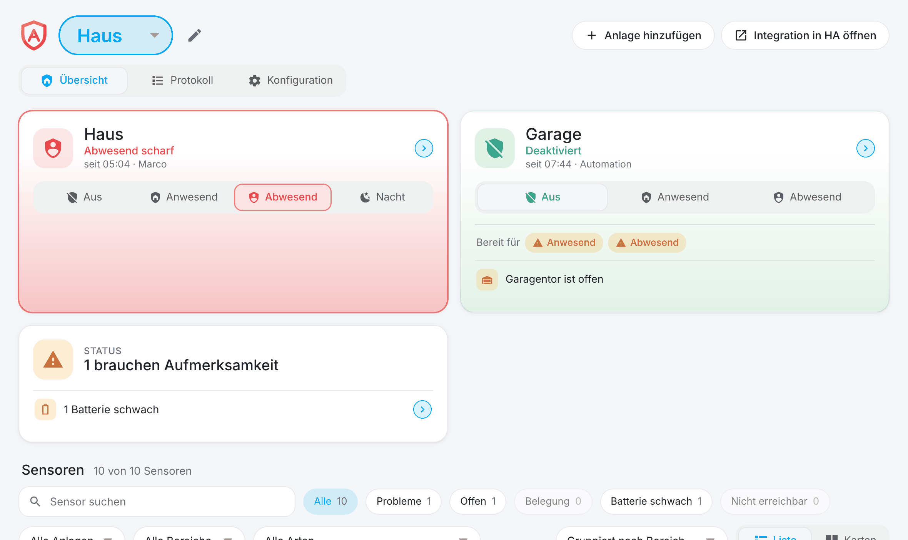
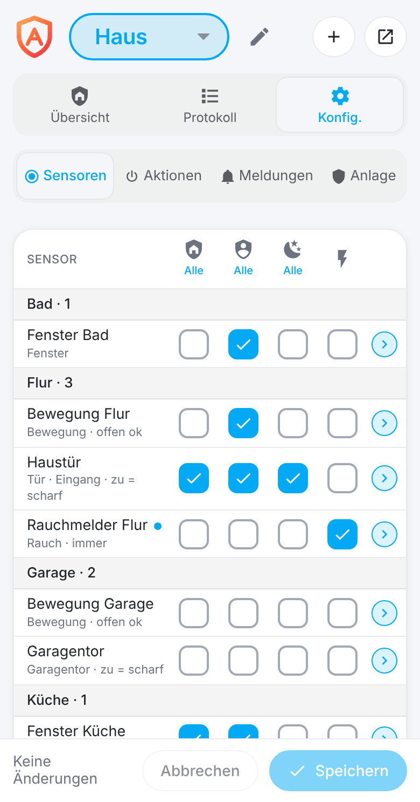
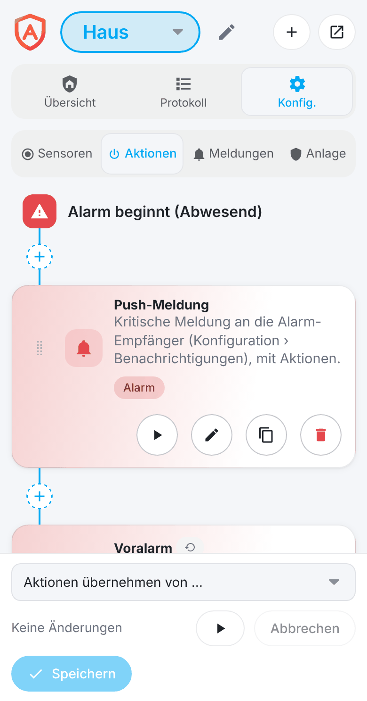
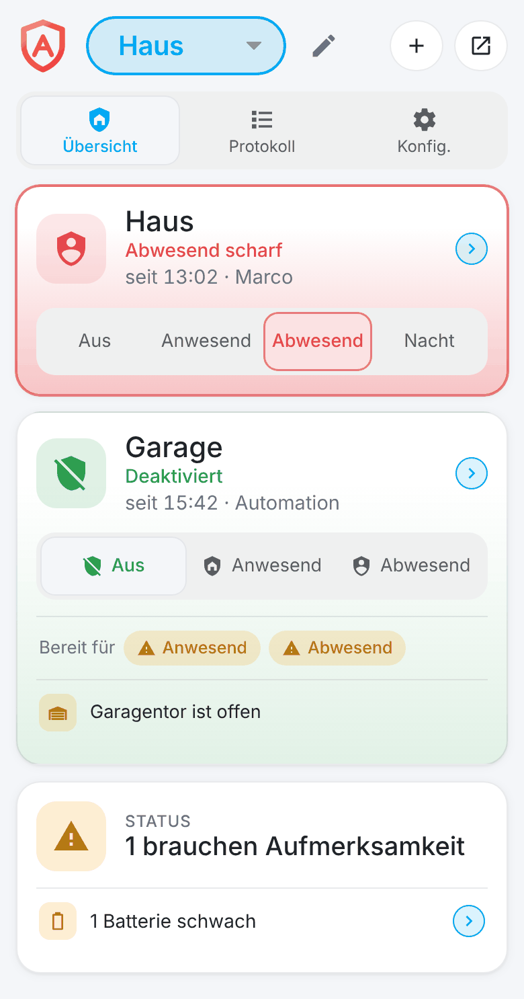
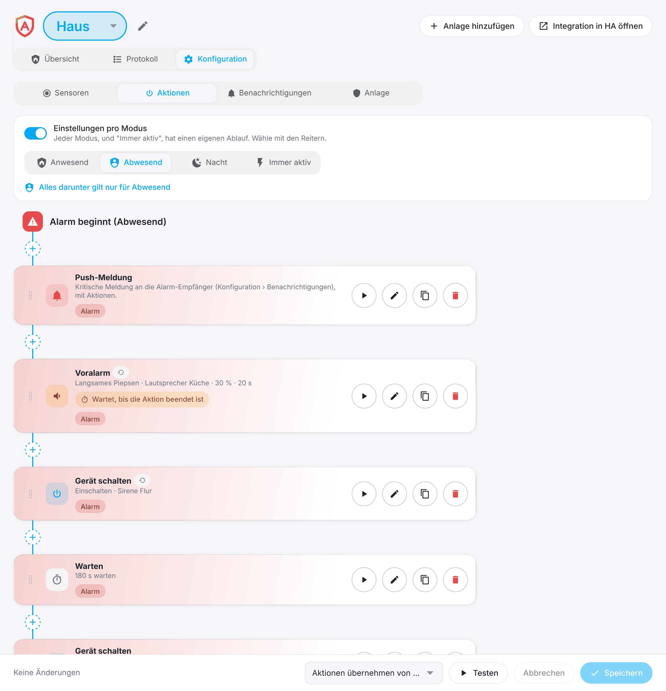
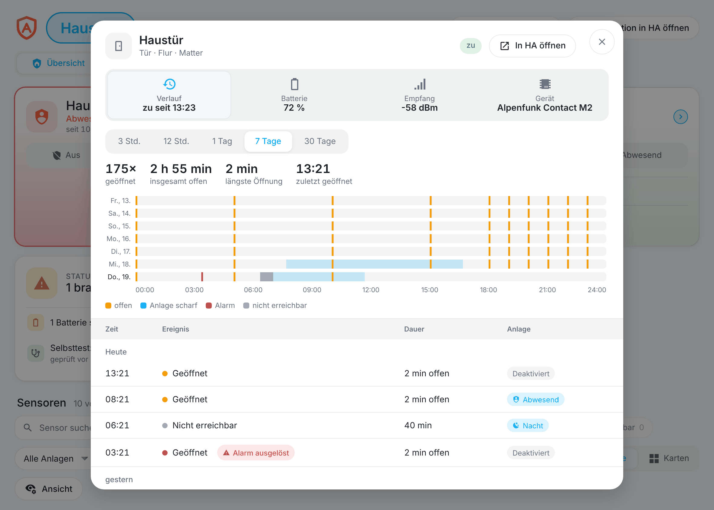
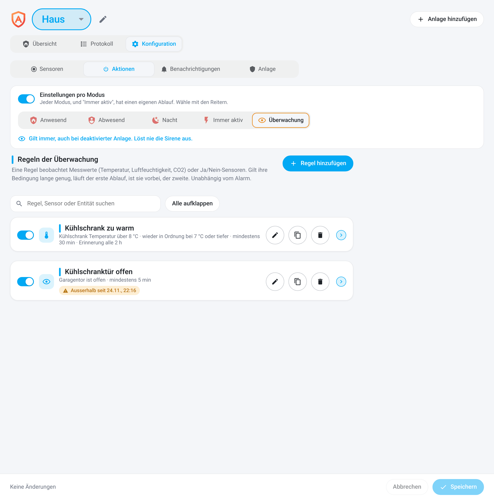
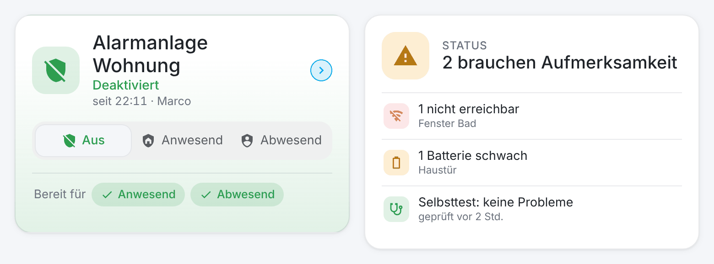

# Alarmageddon

[English](https://github.com/Diegofuego871/ha-alarmageddon/blob/main/README.md)

**Eine vollständige Alarmanlage für Home Assistant, ohne eine einzige Automation.** Du kreuzt an, welche Sensoren wachen, legst fest, was bei einem Alarm passiert, und schaltest scharf. Alles in einem Seitenpanel, am Computer und auf dem Handy; die Push-Meldungen kommen von selbst.

## In drei Schritten

<table>
<tr>
<td width="33%" align="center" valign="top"> <b>1. Sensoren wählen</b> Ankreuzen, welche Sensoren in "Anwesend", "Abwesend" und "Nacht" wachen.</td>
<td width="33%" align="center" valign="top"> <b>2. Alarm festlegen</b> Push-Meldung, Sirene, Licht, Ton: ein Ablauf aus Schritten, jeder mit einem Knopf testbar.</td>
<td width="33%" align="center" valign="top"> <b>3. Scharf schalten</b> Im Panel, auf dem Dashboard, per Routine oder aus jedem System, das Home Assistant kennt.</td>
</tr>
</table>

## Was du bekommst

- **Keine Automationen, kein YAML.** Zonen je Modus, Ein- und Ausgangsverzögerung, Sirene und Alarmton, Routinen nach Zeit oder Gerät, Codes pro Person: alles eingebaut und grafisch eingestellt.
- **Push-Meldungen von selbst.** Alarm, scharf, deaktiviert, Sensor nicht erreichbar, Batterie schwach: Du wählst nur die Empfänger. Die Alarmmeldung bringt ihre Knöpfe mit ("Quittieren", "Deaktivieren"), auf Wunsch kritisch.
- **Sensoren unter Beobachtung.** Batterie mit Prognose, Empfang, letzte Änderung und der Verlauf jedes Sensors über 30 Tage. Fällt ein Sensor im scharfen Zustand aus, erfährst du es.
- **Nachvollziehbar.** Jeder Alarm wird mit Zeitachse aufgezeichnet: welcher Sensor, welche Schritte, welche Meldungen, wer quittiert hat.
- **Im Zweifel alarmieren.** Zustand, Verzögerungen und Alarme überstehen Neustart und Absturz, kein Gerät hält die Sirene auf, ein Wächter beaufsichtigt den Ablauf.
- **Bleibt zu Hause.** Keine Cloud, kein Konto. Jede Anlage ist eine gewöhnliche `alarm_control_panel`-Entität; jeder Sensor von Home Assistant funktioniert (Zigbee, Z-Wave, Thread/Matter, WLAN, Bluetooth).

## Installation

1. **Installieren:** HACS → drei Punkte → "Benutzerdefinierte Repositories" → `https://github.com/Diegofuego871/ha-alarmageddon`, Typ "Integration". "Alarmageddon" installieren und Home Assistant neu starten.
2. **Anlage hinzufügen:** Einstellungen → Geräte & Dienste → "Integration hinzufügen" → "Alarmageddon". Name vergeben und, wenn du willst, einen Code.
3. **Einrichten:** "Alarmageddon" in der Seitenleiste öffnen (nur Administratoren) und unter Konfiguration die drei Schritte von oben durchgehen: Sensoren, Aktionen, Benachrichtigungen. Mit "Testmeldung senden" und dem Abspielknopf eines Schritts probierst du alles ohne Alarm aus.

## Rundgang

### Was bei einem Alarm passiert

Ein Ablauf aus Schritten, auf Wunsch je Modus: Push-Meldung, Gerät schalten, Ton abspielen, Warten, Szene oder eigene Aktion. Eine Aktions-Gruppe wiederholt Schritte, zum Beispiel für ein Blinklicht. Geräte kehren beim Deaktivieren in ihren vorherigen Zustand zurück. Wie lange die Sirene läuft, bestimmst allein du.

### Der Alarm

Ein rotes Band nennt den Sensor, der ausgelöst hat, mit den Knöpfen "Quittieren" (der Alarm endet, die Anlage bleibt scharf) und "Deaktivieren". Dieselben Knöpfe stehen in der Push-Meldung. Jeder Alarm wird vom Auslösen bis zum Quittieren aufgezeichnet (erfundene Daten, links das Handy, rechts der Computer):

 

### Sensoren im Blick

Ein Tipp auf einen Sensor zeigt, was er getan hat: eine Grafik je Sensorart über 3 Stunden bis 30 Tage, die Ereignisse mit dem Zustand der Anlage in diesem Moment, dazu Batterie und Empfang mit Verlauf.

### Überwachung

Neben dem Alarm, standardmässig aus: Regeln für das, was nichts mit Einbrechern zu tun hat. Ein Kühlschrank, der zu warm wird, ein feuchter Keller, schlechte Luft. Sie melden "Ausserhalb der Grenzen" und "Wieder in Ordnung" und lösen nie die Sirene aus.

### Dashboard-Karten

Bedienteil und Status gibt es als Karten für jedes Dashboard ("Karte hinzufügen" › "Alarmageddon"), für alle Personen, die das Dashboard sehen dürfen. Wo ein Code programmiert ist, wird er verlangt.

## Sicherheit

Eine Alarmanlage muss funktionieren, wenn etwas anderes es nicht tut. Das ist eingebaut und wird bei jeder Änderung von Tests geprüft:

- **Neustart und Absturz:** Jeder Wechsel des Zustands wird sofort geschrieben. Eine Eingangsverzögerung, die während eines Neustarts abläuft, wird zum Alarm; ein laufender Alarm geht weiter.
- **Nichts hält die Sirene auf:** Ein Gerät, das nicht antwortet, wird nach 10 Sekunden übergangen; ein scheiternder Schritt stoppt den Rest nie; ein Wächter startet den Ablauf selbst, wenn er ausbleibt.
- **Codes:** nur als Hash mit Salz gespeichert, nie angezeigt, nie in einer Sicherung. Fünf falsche Codes sperren die Anlage für eine Minute.
- **Nur Administratoren** erreichen das Panel und seine Befehle. Knöpfe in Push-Meldungen wirken nur vom Handy eines Empfängers.
- **Ausfälle:** Ein Sensor, der im scharfen Zustand nicht mehr antwortet, wird gemeldet oder zählt auf Wunsch als Alarm.
- **Getestet:** über 1400 automatische Tests gegen ein echtes Home Assistant (in zwei Versionen), rund 6800 Prüfungen der Oberfläche und eine Mutationsprobe, die jede von 347 Schutzmassnahmen ausbaut und verlangt, dass ein Test scheitert.

### Grenzen

Alarmageddon ist keine zertifizierte Alarmanlage:

- Fällt Home Assistant, der Strom, das Netzwerk oder der Funk-Koordinator aus, gibt es keinen Alarm. Für kritische Einsätze hilft eine Sirene mit eigenem Akku.
- Wie lange eine Sirene laufen darf, ist von Ort zu Ort verschieden geregelt. Kläre, was bei dir gilt, und stelle die Dauer in den Alarmaktionen ein.
- Ein Ton "bis zum Deaktivieren" und eine Sirene ohne Schritt "aus" laufen, bis jemand deaktiviert.

## Apple HomeKit

1. Die Alarm-Entität in die HomeKit Bridge von Home Assistant aufnehmen (Domäne `alarm_control_panel` oder die Entität einschliessen).
2. Apple Home zeigt "Aus" und die eingeschalteten Modi.
3. Mit Code: HomeKit fragt nicht danach. Trage ihn in der Konfiguration der HomeKit Bridge ein (`entity_config` → `code`) oder als Standardcode in den Einstellungen der Entität.

## Mehr erfahren

- **[Handbuch](https://github.com/Diegofuego871/ha-alarmageddon/blob/main/docs/MANUAL.de.md):** jede Ansicht und jede Einstellung im Detail, alle Sicherheitsmechanismen, Entitäten, Zahlen und Grenzen, Routinen, Sicherung, Hinweise für Entwickler.
- **[Änderungsprotokoll](https://github.com/Diegofuego871/ha-alarmageddon/blob/main/CHANGELOG.de.md):** was sich in welcher Version geändert hat.
- **Sprachen:** Die Integration ist auf Englisch und wechselt auf Deutsch, wenn Home Assistant auf Deutsch läuft.
- **Lizenz:** siehe [LICENSE](https://github.com/Diegofuego871/ha-alarmageddon/blob/main/LICENSE).
