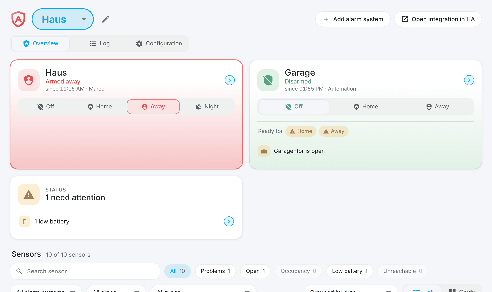
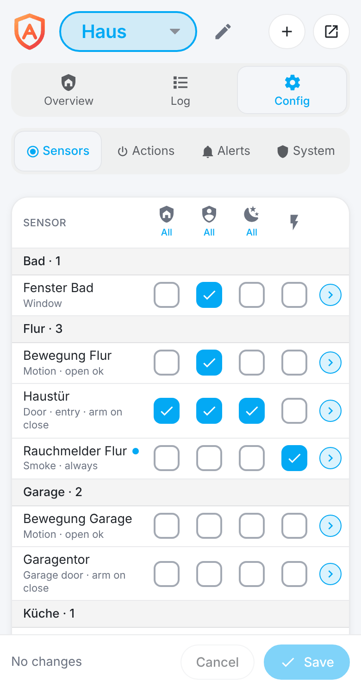
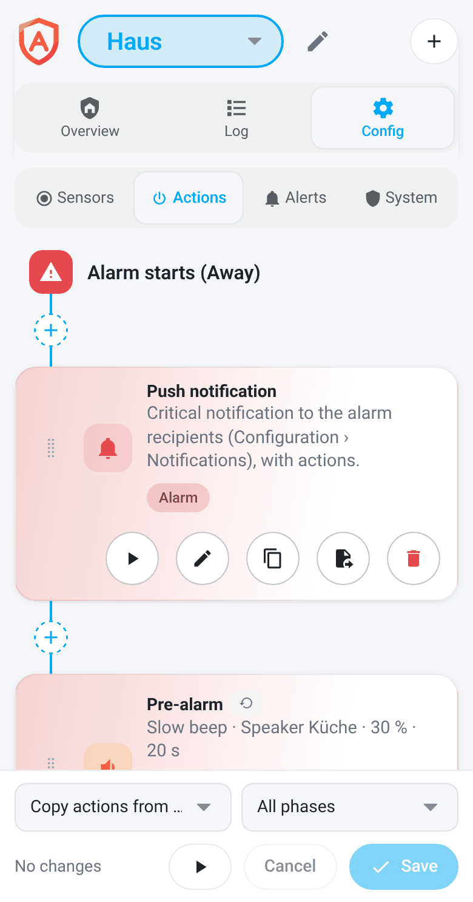
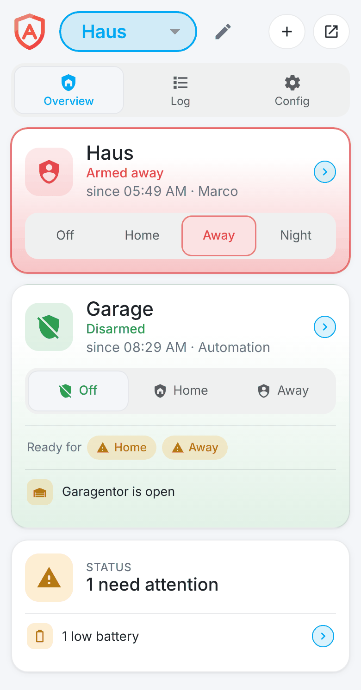
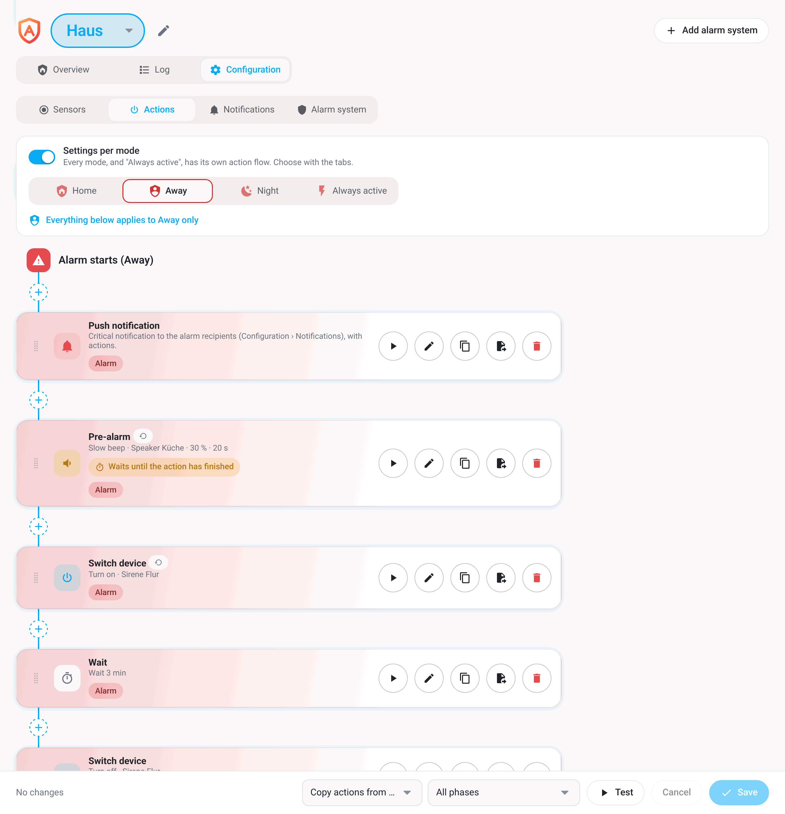
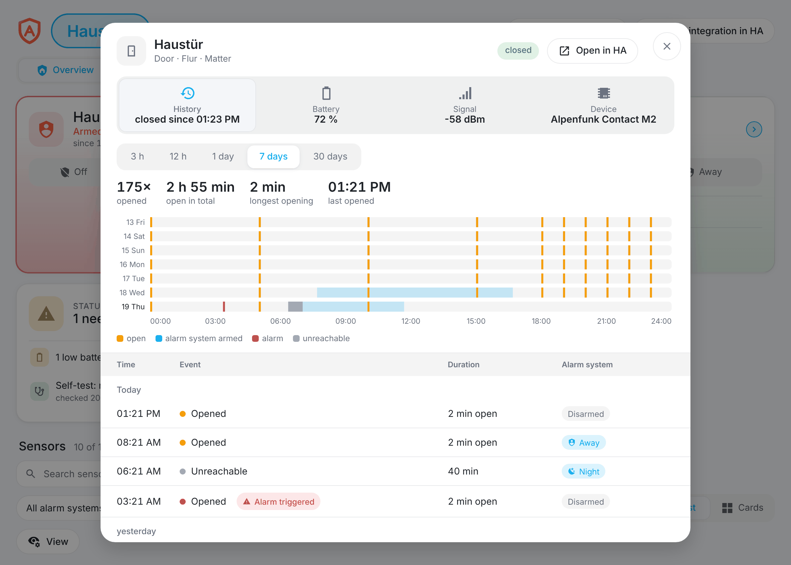
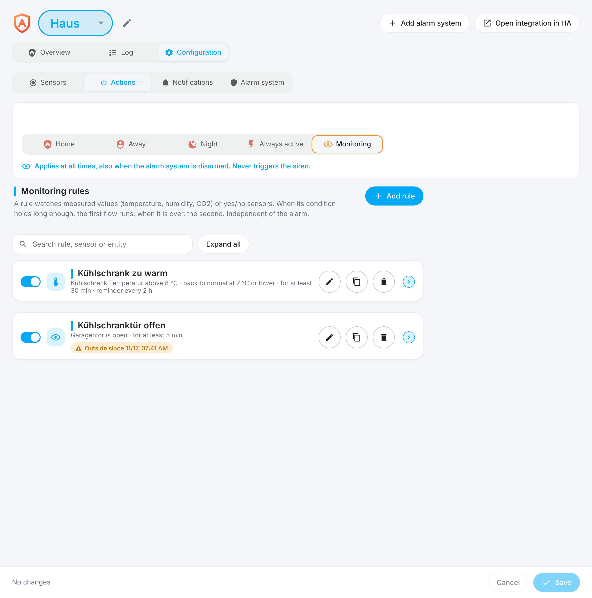
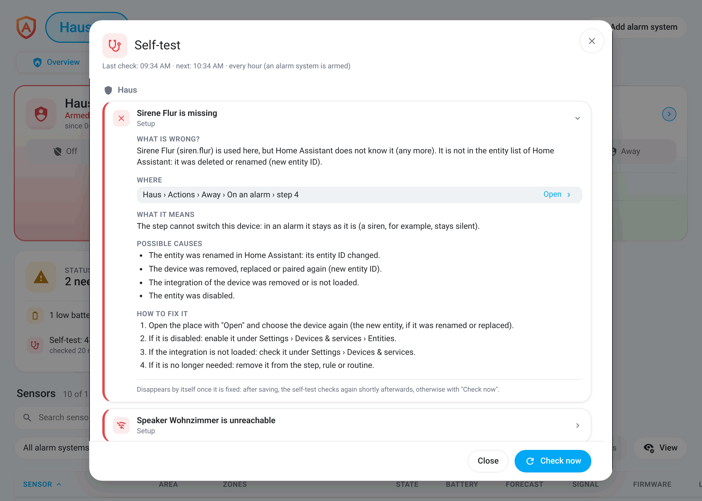
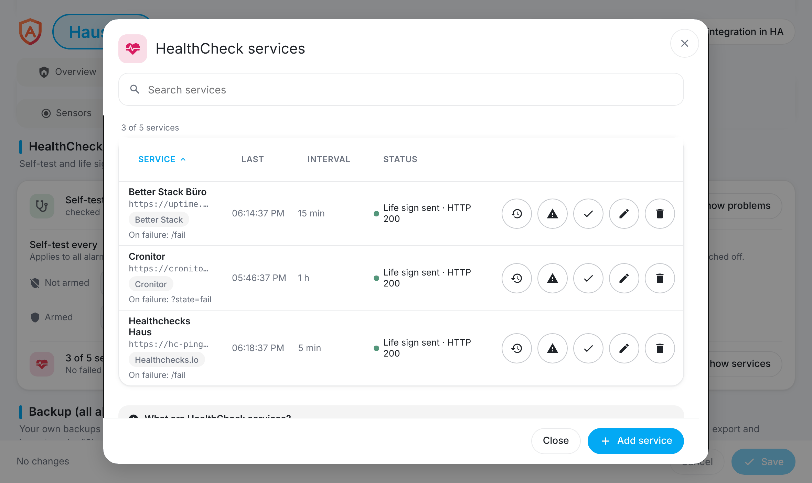
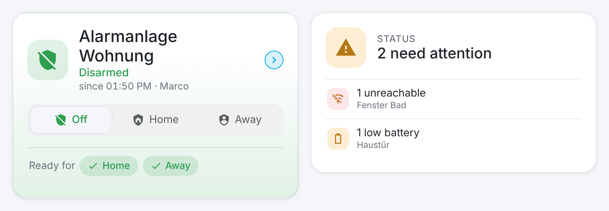

# Alarmageddon

[Deutsch](https://github.com/Diegofuego871/ha-alarmageddon/blob/main/README.de.md)

**A complete alarm system for Home Assistant, without a single automation.** You tick which sensors keep watch, decide what happens on an alarm, and arm. Everything in one side panel, on the computer and on the phone; the push notifications come by themselves, and Alarmageddon keeps an eye on itself.

## In three steps

<table>
<tr>
<td width="33%" align="center" valign="top"> <b>1. Choose the sensors</b> Tick which sensors keep watch in "Home", "Away" and "Night".</td>
<td width="33%" align="center" valign="top"> <b>2. Define the alarm</b> Push notification, siren, light, sound: a flow of steps, each one testable with a button.</td>
<td width="33%" align="center" valign="top"> <b>3. Arm</b> In the panel, on the dashboard, by a routine or from any system Home Assistant knows.</td>
</tr>
</table>

## What you get

- **No automations, no YAML.** Zones per mode, entry and exit delay, siren and alarm sound, routines by time or by device, a code per person: all built in and set up graphically.
- **Push notifications by themselves.** Alarm, armed, disarmed, sensor unreachable, battery low: you only choose the recipients. The alarm notification brings its buttons along ("Acknowledge", "Disarm"), critical if you like.
- **Sensors under observation.** Battery with a forecast, signal, last change and the history of every sensor over 30 days. If a sensor drops out while armed, you are told.
- **More than burglary.** Monitoring rules for the fridge, the cellar or the air report when a value leaves its limits, separate from the alarm and never with the siren.
- **Watches itself.** A self-test checks regularly (every few hours by default, as often as every 5 minutes if you like) whether everything the alarm systems use is still there and reachable. A HealthCheck service outside (Healthchecks.io, Cronitor, Better Stack …) gets a regular life sign and alerts you when Home Assistant falls silent.
- **Traceable.** Every alarm is recorded with a timeline: which sensor, which steps, which notifications, who acknowledged.
- **When in doubt, alarm.** State, delays and alarms survive a restart and a crash, no device holds up the siren, a watchdog supervises the flow.
- **Stays at home.** No cloud, no account. Each alarm system is an ordinary `alarm_control_panel` entity; any sensor of Home Assistant works (Zigbee, Z-Wave, Thread/Matter, Wi-Fi, Bluetooth).

## Installation

1. **Install:** HACS → three dots → "Custom repositories" → `https://github.com/Diegofuego871/ha-alarmageddon`, type "Integration". Install "Alarmageddon" and restart Home Assistant.
2. **Add an alarm system:** Settings → Devices & services → "Add integration" → "Alarmageddon". Give it a name and, if you like, a code.
3. **Set it up:** open "Alarmageddon" in the sidebar (administrators only) and go through the three steps from above under Configuration: sensors, actions, notifications. "Send test message" and the play button of a step let you try everything without an alarm. Under Configuration › Alarm system you find routines, codes per person, your own sounds, HealthCheck and backup.

## A tour

### What happens on an alarm

A flow of steps, per mode if you like: push notification, switch a device, play a sound, wait, scene or your own action. An action group repeats steps, for example for a flashing light. Devices return to their previous state when you disarm. How long the siren sounds is decided by you alone.

### The alarm

A red band names the sensor that triggered, with the buttons "Acknowledge" (the alarm ends, the system stays armed) and "Disarm". The same buttons are in the push notification. Every alarm is recorded from the trigger to the acknowledgement (invented data, the phone on the left, the computer on the right):

 

### Sensors at a glance

A tap on a sensor shows what it did: a chart for each kind of sensor over 3 hours to 30 days, the events with the state of the alarm system at that moment, plus battery and signal with their history. A sensor that a monitoring rule uses also lists its rules, and every limit is drawn in the chart.

### Monitoring

Next to the alarm, off by default: rules for what has nothing to do with burglars. A fridge that gets too warm, a damp cellar, bad air. They report "Outside the limits" and "Back to normal" and never trigger the siren.

### Self-test

Alarmageddon checks itself every few hours (more often while armed; both adjustable from 5 minutes to 24 hours) and after every save: are all sirens, speakers, actions and recipients that the alarm systems use still there and reachable, and did a step, a notification or a life sign fail? The status tile shows the result; a window explains every problem with its causes and how to fix it, with a jump to the right place, and lists everything that was checked, green when in order. Each alarm system has a "Self-test" entity, and Home Assistant lists the problems under Repairs. The self-test only reads: it never switches anything and never holds up an alarm.

### HealthCheck

What if Home Assistant itself fails? Nothing inside it can tell you. Under Configuration › Alarm system › HealthCheck, Alarmageddon sends a life sign to up to five services outside, such as Healthchecks.io, Cronitor, Better Stack or Uptime Kuma, every 1 minute to 24 hours. If the life signs stop, the service alerts you. As long as the self-test has problems, Alarmageddon calls the failure URL instead, so you hear about those too. It works with any service that accepts a simple URL call: for well-known services the failure suffix is suggested, you decide. "Send failure" and "Send life sign" try each service; the chapter also holds the self-test and its two intervals (not armed, armed). The round button "Log" shows for each service, like a sensor, every life sign of up to a year: success rate, response time, failures, tests and gaps. Once services are set up, the status tile of the overview shows the self-test and the services side by side. If a service stops answering, Alarmageddon tells you after the number of failed calls you choose, and again when it answers (Configuration › Notifications).

### Dashboard cards

Keypad and status are available as cards for any dashboard ("Add card" › "Alarmageddon"), for every person who may see the dashboard. Where a code is programmed, it is asked for.

## Safety

An alarm system has to work when something else does not. This is built in and checked by tests on every change:

- **Restart and crash:** every change of state is written at once. An entry delay that runs out during a restart becomes an alarm; a running alarm continues.
- **Nothing holds up the siren:** a device that does not answer is skipped after 10 seconds; a failing step never stops the rest; a watchdog starts the flow itself if it fails to begin.
- **Codes:** stored only as a salted hash, never shown, never in a backup. Five wrong codes lock the alarm system for one minute.
- **Administrators only** reach the panel and its commands. Buttons in push notifications only work from the phone of a recipient.
- **Failures:** a sensor that stops answering while armed is reported, or counts as an alarm if you like.
- **Self-test:** checks regularly whether everything the alarm uses is there and reachable, and records what failed; it only reads and never holds up an alarm.
- **HealthCheck:** life signs to a service outside report a silent Home Assistant. The ping URL appears in full only in the panel and in backups, never in the log or a notification; a life sign waits at most 10 seconds.
- **Tested:** more than 1,500 automated tests against a real Home Assistant (in two versions), about 7,400 checks of the interface, and a mutation check that removes each of 368 safeguards and requires a test to fail.

### Limits

Alarmageddon is not a certified alarm system:

- If Home Assistant, the power, the network or the radio coordinator fails, there is no alarm. A siren with its own battery helps for critical use; a HealthCheck service at least tells you that Home Assistant is silent.
- How long a siren may sound is regulated differently from place to place. Check what applies to you and set the duration in the alarm actions.
- A sound "until disarmed" and a siren without an "off" step run until someone disarms.

## Apple HomeKit

1. Add the alarm entity to the HomeKit Bridge of Home Assistant (include the domain `alarm_control_panel` or the entity).
2. Apple Home shows "Off" and the modes that are switched on.
3. With a code: HomeKit does not ask for it. Set it in the HomeKit Bridge configuration (`entity_config` → `code`) or as default code in the entity settings.

## Learn more

- **[Manual](https://github.com/Diegofuego871/ha-alarmageddon/blob/main/docs/MANUAL.md):** every view and every setting in detail, all safety mechanisms, entities, numbers and limits, routines, self-test, HealthCheck, backup, notes for developers.
- **[Changelog](https://github.com/Diegofuego871/ha-alarmageddon/blob/main/CHANGELOG.md):** what changed in which version.
- **Languages:** the integration is in English and switches to German when Home Assistant runs in German.
- **License:** see [LICENSE](https://github.com/Diegofuego871/ha-alarmageddon/blob/main/LICENSE).
