# Alarmageddon: Handbuch

[English](https://github.com/Diegofuego871/ha-alarmageddon/blob/main/docs/MANUAL.md) · [Zurück zur Übersicht](https://github.com/Diegofuego871/ha-alarmageddon/blob/main/README.de.md)

Alle Einzelheiten zu Alarmageddon. Der schnelle Einstieg (Idee, Installation, Rundgang) steht in der [README](https://github.com/Diegofuego871/ha-alarmageddon/blob/main/README.de.md).

## Inhalt

- [Die Oberfläche](#die-oberfläche): Einrichtungsassistent, Übersicht, Sensoransicht, Sensoren und Zonen, Alarmaktionen, Benachrichtigungen, Selbsttest, HealthCheck, Überwachung, Alarm, Protokoll, Dashboard-Karten
- [Sicherheitsmechanismen](#sicherheitsmechanismen) und ihre Grenzen
- [Apple HomeKit](#apple-homekit)
- [Entitäten](#entitäten)
- [Gut zu wissen](#gut-zu-wissen): Ablauf eines Alarms, Zahlen und Grenzen, Optionen pro Sensor, Aktionen, Routinen, Backup, für Entwickler

## Die Oberfläche

### Einrichtungsassistent

Eine neue Anlage öffnet von selbst den Einrichtungsassistenten, einmal, beim ersten Mal, wenn das Panel sie zeigt (ob sie im Panel oder unter Einstellungen › Geräte & Dienste hinzugefügt wurde). Er fragt nur das Wichtigste und erklärt unterwegs, was es bedeutet:

1. **Modi:** "Anwesend", "Abwesend" und "Nacht", und ob Rauch, Wasser und Gas in jedem Zustand auslösen ("Immer aktiv", empfohlen).
2. **Sensoren:** alle passenden Sensoren von Home Assistant, mit Filtern (Türen & Fenster, Bewegung, Rauch & Wasser, Weitere) und Suche.
3. **Zuordnung und Eingang:** die Tabelle aus Konfiguration › Sensoren, vorbelegt nach Sensorart: Türen und Fenster in jedem Modus, Bewegung nur bei Abwesend, Rauch, Wasser und Gas immer. Darunter die Eingangstür (auf dem Handy mit einem Schalter je Sensor), die Zeit zum Verlassen bei Abwesend und die Zeit zum Deaktivieren.
4. **Code (freiwillig):** das Formular der Codes pro Person, mit dem eigenen Benutzer und Namen vorbelegt. Ein Hauptcode aus der Einrichtung in Home Assistant zählt.
5. **Meldungen:** wer Alarmmeldungen und wer Wartungsmeldungen bekommt (beide gelten für alle Anlagen), ein Schalter je Meldung und zwei Testmeldungen, eine an die Empfänger von Alarmen und eine an die Empfänger von Wartungsmeldungen. Kritisch, Lautstärke, eigene Texte und eigene Empfänger bleiben unter Benachrichtigungen.
6. **Alarmaktionen:** der Editor aus Konfiguration › Aktionen, dazu schnell hinzuzufügen "Sirene 3 Minuten" und "Alarmton".
7. **Überwachung:** nur, wenn Home Assistant passende Messwert-Sensoren hat oder die Überwachung schon an ist. Einschalten gilt sofort. Die Liste der Messwerte beginnt leer; "Messwerte hinzufügen" öffnet ein Fenster wie "Sensoren hinzufügen" mit Suche und Filtern (Temperatur, Luftfeuchtigkeit, Helligkeit, Luftqualität, Weitere, nur die vorhandenen), in dem du die gewünschten ankreuzt. Die gewählten stehen in einer Liste fester Höhe mit ihrem jetzigen Wert, Suche, denselben Filtern und einem Papierkorb zum Entfernen; Hinzufügen und Entfernen gelten sofort.

"Fertig" fasst alles zusammen, mit "Ändern" je Schritt, einem Test der Alarmaktionen, einer Testmeldung an die Empfänger von Alarmen und einer an die Empfänger von Wartungsmeldungen und "Bereit zum Scharfschalten" je Modus. "Weitere Funktionen" nennt Routinen, Codes pro Person, eigene Töne, HealthCheck und die Dashboard-Karte, je mit dem Ort, wo sie stehen, und dem Symbol in der Farbe ihres Kapitels; seit 1.74.0 springt ein runder Pfeil in jeder Zeile (ausser bei der Dashboard-Karte, die im Dashboard von Home Assistant steht) direkt zur Funktion, Konfiguration › Anlage öffnet sich mit dem Fenster, und das Schliessen des Fensters führt zurück in den Assistenten auf denselben Schritt, ohne etwas abzuschliessen (offene Änderungen, etwa an Routinen, fragen vorher); "Konfiguration öffnen" schliesst den Assistenten wie "Fertig" ab und öffnet Konfiguration › Anlage. Die Testmeldungen im Schritt "Meldungen" speichern die Auswahl dieser Seite selbst; jede ist frei, sobald ihre Gruppe einen Empfänger hat.

Jeder Schritt wird mit "Weiter" gespeichert, über dasselbe Speichern wie die Reiter der Konfiguration; "Zurück" und am Computer die Schrittliste links führen zu früheren Schritten. Auf dem Handy teilen sich "Zurück" und "Weiter" die Fusszeile zu gleichen Teilen. "Später" (oder Escape) fragt: "Morgen wieder anzeigen" öffnet den Assistenten am nächsten Tag (Datum von Home Assistant) genau beim Schritt, bei dem du aufgehört hast, "Nicht mehr anzeigen" lässt ihn, bis du ihn selbst startest. Solange er nicht fertig ist, steht im Kopf jedes Reiters neben dem Stift ein runder Knopf mit Zauberstab: er führt beim Schritt weiter, bei dem du aufgehört hast (der Tooltip nennt ihn). Einmal je Laden des Panels, fünf Sekunden nachdem er erscheint, schwingt der Zauberstab kurz. Nach "Fertig" und nach "Nicht mehr anzeigen" ist der Knopf weg (ab 1.83.0). Unter Konfiguration › Anlage › Einrichtungsassistent, direkt vor "Anlage löschen", siehst du, wo er steht, und startest ihn erneut, bei diesem Schritt oder von vorn; was eingerichtet ist, ist vorgewählt. Ungespeicherte Änderungen der Konfiguration verwirft er nur nach einer Rückfrage. Anlagen, die es vor Version 1.69.0 gab, und Anlagen aus einem Backup bekommen ihn nicht von selbst; sein Stand gehört nicht ins Backup.

<p align="center">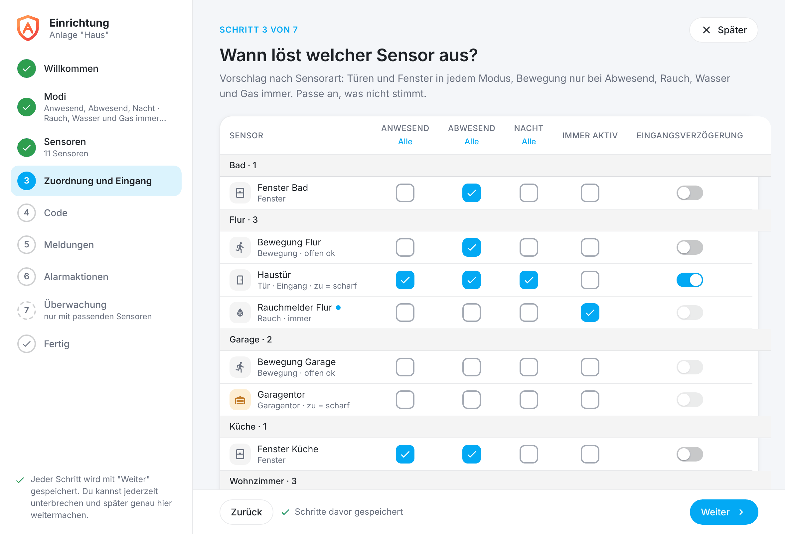</p>

### Übersicht

Alle Anlagen auf einen Blick: scharf schalten und deaktivieren, "Bereit für" je Modus mit den Sensoren, die das Scharfschalten noch verhindern, eine Statuskachel für Warnungen und alle Sensoren als Liste oder als Karten (alle gleich hoch), mit Suche, Filtern, Sortierung, wählbaren Spalten und Gruppierung nach Bereich, Sensorart oder Anlage. Ein Tipp auf einen Sensor öffnet seine Ansicht: was er in den letzten Stunden oder bis zu 30 Tagen getan hat (mit einer Grafik je Sensorart und der Liste der Ereignisse), wie es um Batterie und Empfang steht, und ein Knopf, der ihn in Home Assistant öffnet. In der Ansicht wählst du auch, wie die Sensoren heissen: "Gerät - Sensor" oder nur der Name des Sensors, überall gleich bis in die Push-Meldung. Dasselbe auf dem Handy:

<p align="center">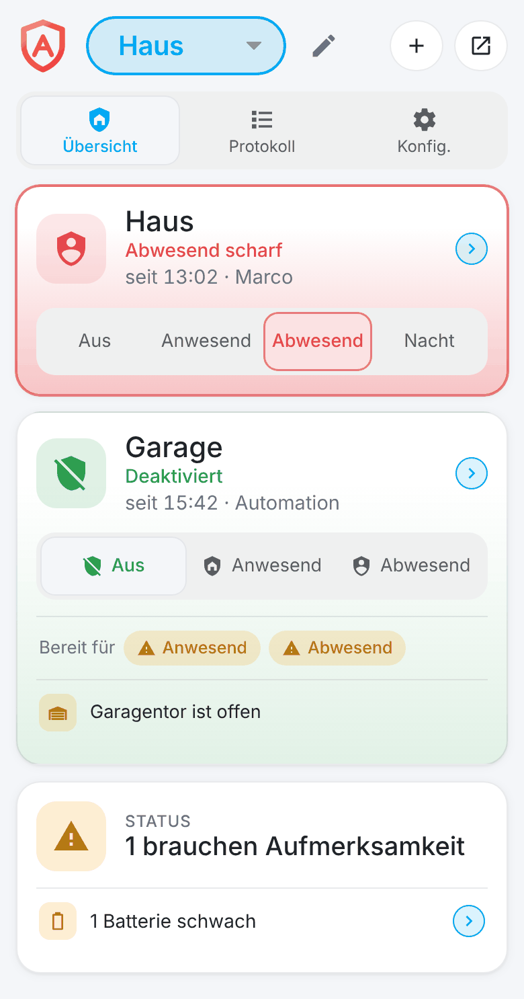</p>

### Sensoransicht

Ein Tipp auf einen Sensor zeigt, was er getan hat: je Sensorart eine eigene Grafik über 3 Stunden bis 30 Tage (Türen und Fenster als Zeitleiste, Bewegung als Raster aus Tag und Stunde), darunter die Ereignisse mit Dauer und dem Zustand der Anlage in diesem Moment. Die Kachel "Verlauf" sagt, seit wann der jetzige Zustand gilt: seit der letzten echten Änderung zwischen offen und zu (bei Bewegung das Ende der letzten Bewegung), nie seit einem Neustart von Home Assistant; ist der Sensor nicht erreichbar, seit Beginn des Ausfalls; ohne bekannte Änderung steht nur der Zustand da. Die Liste enthält immer die Ereignisse des gewählten Zeitraums, ebenso die Zahl auf ihrem Reiter "Ereignisse" (Sensoren der Überwachung); bei mehr als 300 zeigt die Liste die neuesten 300 und sagt das darunter. Die Kacheln "Batterie" und "Empfang" zeigen deren Verlauf, die Batterie mit Warnschwelle, Batteriewechsel und Prognose. "Empfang" gibt es auch für Bluetooth- und ZHA-Geräte ohne Empfangssensor: Alarmageddon liest den Wert von Home Assistant selbst (bei mehreren Bluetooth-Adaptern oder Proxys zählt der stärkste, ohne Hin und Her) und zeichnet den Verlauf selbst auf. Du siehst nur den Wert und die Grafik. Thread-Geräte (Matter) funktionieren gleich, über die Nachbartabelle des Geräts.

<p align="center">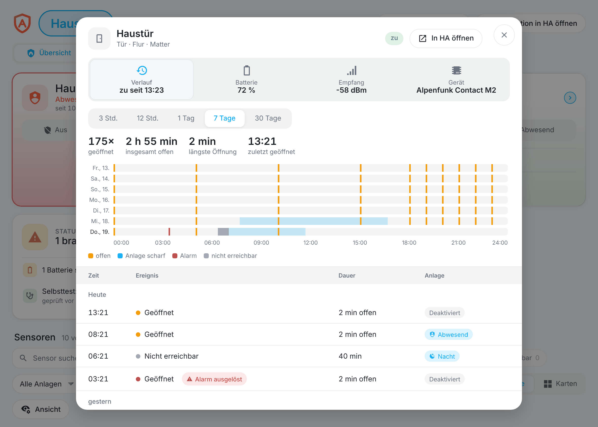</p>

### Sensoren und Zonen

Eine Tabelle für Sensoren und Zonen: ankreuzen, wohin ein Sensor gehört, oder über mehrere Kästchen ziehen. Jede Sensorart hat sinnvolle Voreinstellungen (ein Rauchmelder ist immer aktiv, ein Bewegungsmelder darf beim Scharfschalten noch Bewegung melden), jeder Sensor kann eigene Werte haben, und der Schalter "Einstellungen pro Modus" bringt einen Reiter je Modus für alle, die mehr wollen. Der runde Stift am Ende einer Zeile öffnet die Einstellungen des Sensors; am Computer entfernt der runde Papierkorb daneben den Sensor. "Sensoren hinzufügen" zeigt jeden Sensor von Home Assistant, den Alarmageddon erkennt und der noch nicht in der Tabelle steht. Über der Tabelle und in diesem Fenster grenzen Filter die Liste ein: Türen und Fenster, Bewegung, Wasser und, bei eingeschalteter Überwachung, Temperatur, Luftfeuchtigkeit, Helligkeit und Luftqualität; "Weitere" nimmt alles Übrige (Rauch, Gas, Hitze, Erschütterung, Sabotage, Geräusch, Glasbruch und Ähnliches, Luftdruck). Es erscheinen nur die Filter, zu denen es Sensoren gibt.

<p align="center">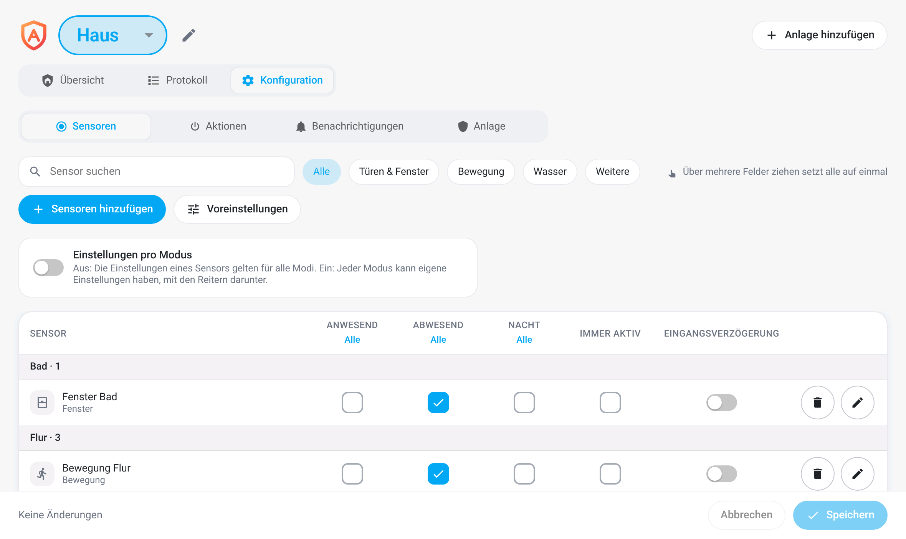</p>

### Alarmaktionen

Was bei einem Alarm passiert, ist ein Ablauf aus Schritten, auf Wunsch je Modus. Geräte mit dem Pfeilsymbol kehren beim Deaktivieren in ihren vorherigen Zustand zurück, und jeder Schritt lässt sich mit seinem Abspielknopf an den echten Geräten testen.

<p align="center">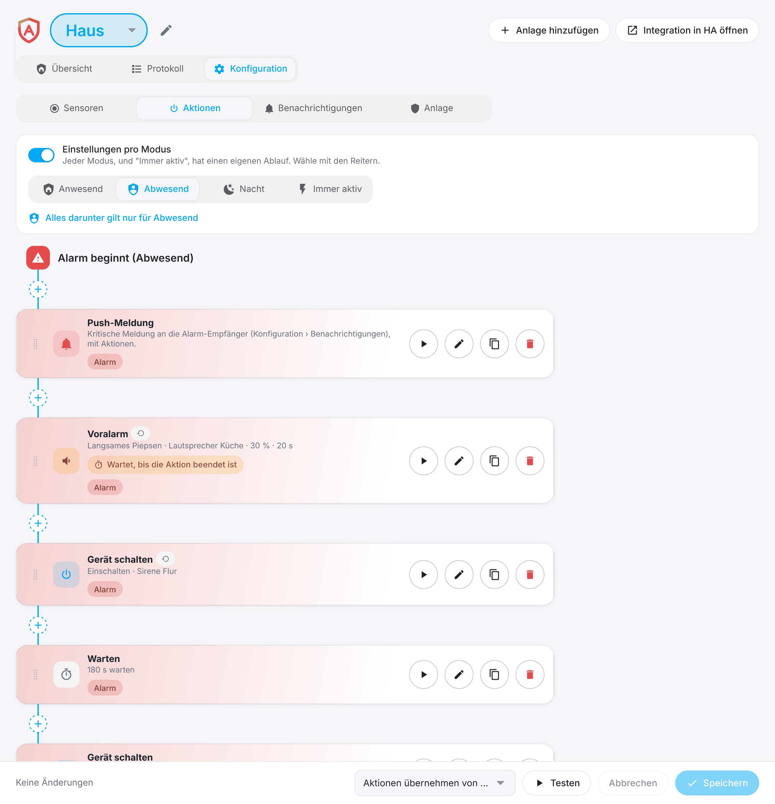</p>

<p align="center">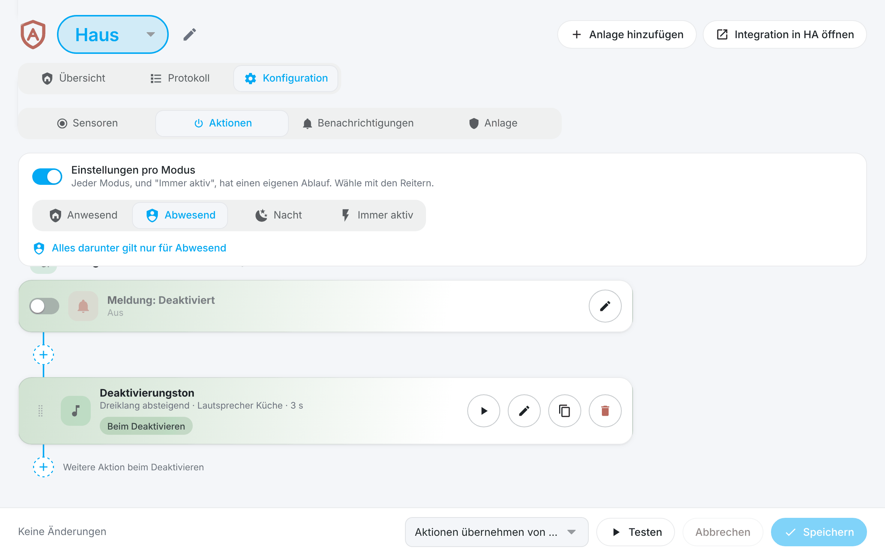</p>

| Schritt | Macht |
| --- | --- |
| Push-Meldung | Kritische Alarmmeldung an die Alarm-Empfänger, mit eigenem Titel und Text (Platzhalter für Anlage, Sensor, Sensorart, Bereich, Uhrzeit, Modus und Alarmart; Rauch-, Wasser-, Gas- und Hitzesensoren bringen einen passenden Standardtext mit), wählbaren Knöpfen und auf Wunsch eigenen Empfängern (jeder Titel beginnt mit einem Emoji) |
| Gerät schalten | Lichter, Steckdosen, Sirenen, Storen, Schlösser und mehr: ein, aus, öffnen, schliessen, mit Helligkeit oder Position; auf Wunsch nach einer eingestellten Zeit rückgängig (Steckdose mit Sirene: ein, nach 2 Minuten aus) |
| Alarmton abspielen | Einer von fünf Tönen auf Medienplayern, mit Lautstärke, für eine Dauer oder bis zum Deaktivieren |
| Warten | Hält die folgenden Schritte an, zum Beispiel zwischen "Sirene ein" und "Sirene aus" |
| Alarm beenden (quittieren) | Beendet den Alarm nach den Schritten davor (zum Beispiel nach 3 Minuten), stellt die Geräte zurück und lässt die Anlage scharf; die Schritte danach laufen nicht mehr |
| Szene, Skript oder eigene Aktion | Alles andere, was Home Assistant kann |
| HealthCheck melden | Meldet an einen externen HealthCheck-Dienst, den du eingerichtet hast (siehe HealthCheck), zum Beispiel beim Alarm: die Aktion ruft die Adresse des Dienstes mit einem eigenen Zusatz auf. Steht ausgegraut mit einem kurzen Hinweis da, bis es einen Dienst gibt (dann ist sie wählbar); in jeder Liste der Aktionen, nicht in der Überwachung |
| Aktions-Gruppe | Wiederholt mehrere Aktionen in ihrer Reihenfolge (zum Beispiel ein Blinklicht): eine Anzahl Durchläufe, für eine Dauer oder bis deaktiviert wird |

Auf derselben Seite stehen die Meldungen des Ablaufs als feste Elemente an ihrem Punkt: "Scharf geschaltet", "Stiller Alarm", "Eingangsverzögerung", "Deaktiviert" und die Abschlussmeldung unter "Alarm endet". Alle fünf sind gleich aufgebaut: Schalter (senden ja oder nein), Play (Testmeldung) und Stift (eigener Text, Empfänger, kritisch). Vor dem Alarm steht das Kapitel "Bei einem stillen Alarm" mit eigenen Aktionen für Sensoren mit der Option "Stiller Alarm".

<p align="center">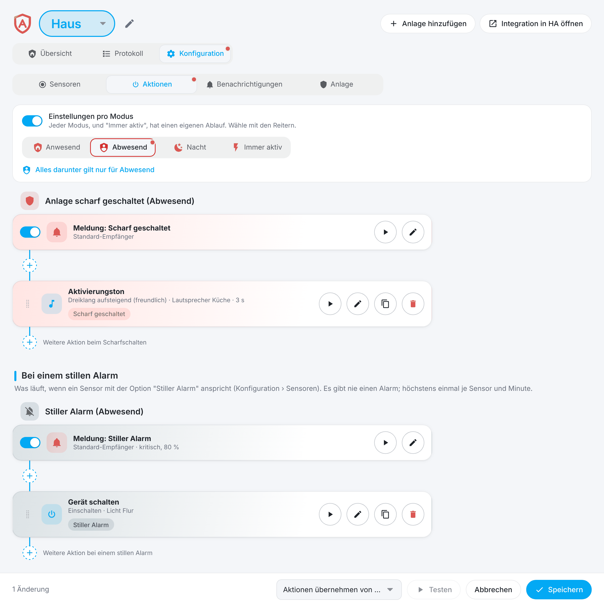</p>

### Benachrichtigungen

Die Standard-Empfänger wählst du getrennt für Alarme und für Wartungsmeldungen, und jede Meldung kann sie mit eigenen Empfängern überschreiben. Darunter folgen die Kapitel "Störungsmeldungen" (Sensor im scharfen Zustand nicht erreichbar, Scharfschalten nicht möglich) und "Wartungsmeldungen" (Batterie schwach, Sensor nicht erreichbar, Selbsttest, HealthCheck-Dienst antwortet nicht). Seit 1.69.0 ist jede Meldung eine Karte wie die festen Meldungen im Reiter Aktionen: Schalter, Symbol in der Farbe ihres Kapitels (Störungsmeldungen rot, Wartungsmeldungen orange, ausgeschaltet grau), Titel und eine Kurzfassung (an wen, kritisch, "bleibt in Home Assistant stehen" und die eigenen Einstellungen, zum Beispiel "unter 20 % · nach 3 Prüfungen"), Play (Testmeldung mit den gespeicherten Einstellungen; gesperrt, solange Änderungen offen sind oder die Meldung aus ist) und Stift. Am Computer stehen die Karten in zwei Spalten, auf dem Handy in einer.

Der Stift öffnet das Fenster der Meldung, mit denselben Abschnitten für jede Meldung: "Meldung senden" (ein oder aus), Empfänger (Standard: die Standard-Empfänger ihres Kapitels; wer andere wählt, gibt der Meldung eigene Empfänger, "Zurück zum Standard" entfernt sie), Zustellung (Kritisch, ertönt auch im Stumm-Modus, mit eigener Lautstärke; "Zusätzlich als Benachrichtigung in Home Assistant stehen lassen") und, wo die Meldung welche hat, ihre eigenen Einstellungen. Zahlen sind einheitlich: Beschriftung links, Feld und Einheit rechts in einer Flucht, der Hinweis darunter. "Batterie schwach" hat "Schwach unter … %" und "Meldung nach … Prüfungen" (die Batterie muss so viele Prüfungen hintereinander unter der Schwelle liegen; die Wartung prüft alle 15 Minuten); "Sensor nicht erreichbar" hat "Nicht erreichbar nach … Minuten"; "HealthCheck-Dienst antwortet nicht" hat "Meldung nach … Fehlversuchen" (1 bis 10 hintereinander, Standard 2; es zählt jeder automatische Aufruf, nie der Testknopf) und "Melden, wenn er wieder antwortet" (Standard an: einmal, beim ersten Aufruf, der wieder klappt; dieselben Empfänger, nie kritisch, ersetzt die Meldung "antwortet nicht"). Ihre Texte sind fest und enthalten nie die URL; ein Tipp darauf öffnet die Liste der HealthCheck-Dienste. Ein gescheitertes Lebenszeichen geht nicht über die Meldung "Selbsttest" hinaus; es bleibt ein Problem des Selbsttests, dessen Abstand unter Konfiguration › Anlage › HealthCheck steht. "Übernehmen" überträgt die Änderungen auf die Seite, gespeichert werden sie wie überall mit "Speichern" unten; bis dahin zeigt die Karte "Noch nicht gespeichert" mit dem orangen Punkt. "Abbrechen", X und Escape fragen, bevor sie Änderungen im Fenster verwerfen.

Mit eingeschalteten "Einstellungen pro Modus" bekommt "Sensor im scharfen Zustand nicht erreichbar" eigene Werte je Modus (Reiter der Modi; Karte und Fenster nennen den Modus, ein eigener Wert zeigt "Zurück zum Grundwert"). Die Meldungen "Scharf geschaltet", "Deaktiviert", "Eingangsverzögerung" und "Stiller Alarm" stehen im Reiter Aktionen, an ihrem Punkt im Ablauf jeder Anlage. "Scharfschalten nicht möglich" trägt zwei Knöpfe, jeder mit seinem Schalter im Fenster: "Erneut versuchen" schaltet denselben Modus noch einmal scharf, "Trotzdem scharf schalten" schaltet scharf, obwohl Sensoren offen sind, und übergeht sie bis zum Deaktivieren. Sie gelten eine Stunde, nur solange die Anlage deaktiviert ist und nur vom Handy eines Empfängers dieser Meldung.

### Selbsttest

Alarmageddon prüft sich regelmässig selbst. Gibt es alle Geräte, Lautsprecher, Aktionen (Dienste), Empfänger und eigenen Töne noch, die die Aktionen, die Regeln der Überwachung, die Routinen und die Benachrichtigungen verwenden, und sind sie erreichbar? Gibt es die Sensoren der Anlagen noch, und hat Home Assistant eine Adresse für die Lautsprecher? Im Betrieb hält er zudem fest: Schritte, die scheiterten oder nicht innerhalb von 10 Sekunden antworteten, Eingriffe des Wächters, Meldungen, die nicht hinausgingen, Teile einer Anlage, die nicht starteten, ein gescheitertes automatisches Backup und Lebenszeichen an die HealthCheck-Dienste, die nicht hinausgingen.

- **Wann:** wenige Minuten nach dem Start von Home Assistant (die Geräte verbinden sich erst), kurz nach jedem Speichern, alle 6 Stunden und jede Stunde, solange eine Anlage scharf, also nicht deaktiviert ist (beides von 5 Minuten bis 24 Stunden, je als Zahl und Einheit, Minuten oder Stunden, unter Konfiguration › Anlage › HealthCheck, "Selbsttest alle", "Nicht scharf" und "Scharf" untereinander, gespeichert mit "Speichern" der Seite; nach dem Scharfschalten folgt die nächste Prüfung innert einer Minute, sobald der Abstand für scharf vergangen ist) und mit "Jetzt prüfen" (im Fenster des Selbsttests und im Kapitel HealthCheck).
- **Im Panel:** Die Statuskachel der Übersicht zeigt immer eine Zeile "Selbsttest" mit der Zeit der letzten Prüfung; Probleme zählen bei "N brauchen Aufmerksamkeit" mit (rot, wenn ein Problem einen Alarm verhindern oder stumm machen kann). Sind HealthCheck-Dienste eingerichtet (seit 1.68.0), ist diese Zeile in der Mitte geteilt, ohne dass die Kachel höher wird: links "Selbsttest", rechts "HealthCheck" (grün, wenn alle Dienste in Ordnung sind, orange, solange ein Fehler gemeldet ist, rot, sobald einer gescheitert ist; ein Tipp öffnet die Liste der Dienste). Ohne Dienste bleibt die Zeile wie bisher. Ein Klick öffnet ein Fenster mit allen Problemen, je Anlage und unter "Alle Anlagen": was los ist, wo (mit "Öffnen", das zum Schritt, zur Regel, zur Routine oder zur Einstellung springt), was es bedeutet, mögliche Ursachen und wie man es behebt.
- **Geprüft:** Der runde Pfeil in der Karte "Keine Probleme gefunden" (mit Problemen: in der Karte "N Einträge geprüft" darunter) öffnet die Liste von allem, was die letzte Prüfung angeschaut hat, gruppiert: Sensoren der Anlagen, Sensoren der Überwachung, Geräte in den Aktionen, Lautsprecher, Geräte, die Routinen auslösen, Aktionen (Dienste) und Empfänger. Jeder Eintrag zeigt seinen Namen und die Entitäts-ID (bei mehreren Anlagen auch, wo er verwendet wird) und ein grünes Häkchen, wenn er in Ordnung ist, sonst ein Warnzeichen; ein Suchfeld findet Einträge. Die Liste gehört zur letzten Prüfung und bleibt über einen Neustart erhalten.
- **Was zählt:** Ein Gerät, das ein Schritt schaltet (Sirene, Schalter, Lautsprecher), zählt, sobald es seit 5 Minuten nicht erreichbar ist, nicht erst, wenn es fehlt. Sensoren der Anlagen und der Überwachung zählen nur, wenn sie fehlen; nicht erreichbare Sensoren melden die Wartungsmeldungen (keine doppelte Meldung). Abläufe eines ausgeschalteten Modus werden nicht geprüft.
- **Verschwinden:** Ein Problem der Einrichtung verschwindet von selbst, sobald es behoben ist (bei der nächsten Prüfung; nach dem Speichern prüft der Selbsttest kurz danach erneut). Ein Problem im Betrieb verschwindet, sobald derselbe Aufruf wieder klappt, im Alarm oder im Test, oder mit "Erledigt" im Fenster.
- **Anderswo:** Jede Anlage hat eine Entität "Selbsttest" (Problem; ihre eigenen Probleme und die für alle Anlagen), die Statusentität und die Infokarte zählen die Probleme mit, und Home Assistant zeigt sie unter Einstellungen › Reparaturen (eine Meldung je Anlage, eine für alle). Die Wartungsmeldung "Selbsttest" meldet jedes neue Problem einmal.
- **Nur lesen:** Der Selbsttest schaltet nie ein Gerät, spielt keinen Ton und sendet keine Testmeldung. Er hält nie einen Alarm auf: ein Fehler im Selbsttest bleibt im Selbsttest.

### HealthCheck

Fällt Home Assistant selbst aus (Strom, Absturz, kein Internet), kann nichts darin das melden. Ein HealthCheck-Dienst draussen kann es: Alarmageddon schickt ihm in einem festen Abstand ein Lebenszeichen, und bleiben die Lebenszeichen aus, meldet sich der Dienst per E-Mail, Push oder SMS, je nach Dienst. Unter Konfiguration › Anlage haben das Kapitel "Selbsttest" (letzte Prüfung, "Jetzt prüfen", "Probleme anzeigen", "Selbsttest alle") und das Kapitel "HealthCheck" (die Lebenszeichen) je eine eigene Kachel; beide gelten für alle Anlagen.

<p align="center">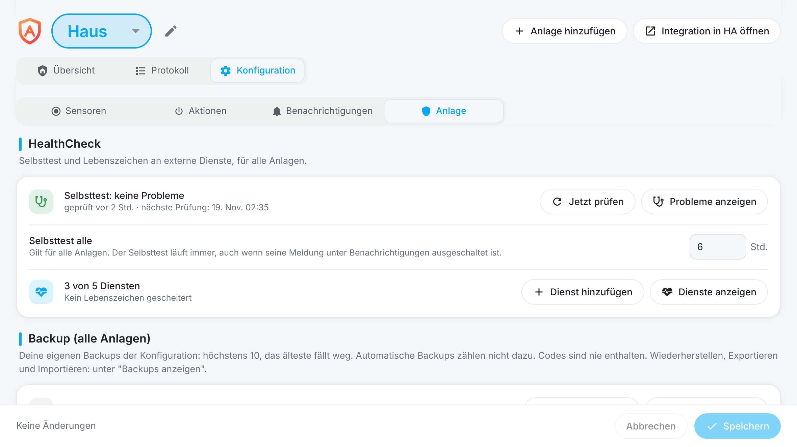</p>

- **Dienste:** bis zu 5, zum Beispiel Healthchecks.io, Cronitor, Better Stack oder Uptime Kuma; es geht jeder Dienst, der einen einfachen Aufruf einer URL (GET) annimmt. Die Zeile im Kapitel zeigt, wie viele eingerichtet sind und als Ampel, ob ein Lebenszeichen gescheitert ist (grüner Punkt und "Alles in Ordnung", oder roter Punkt und "1 Dienst: letztes Lebenszeichen gescheitert"), mit "Dienst hinzufügen" und "Dienste anzeigen". Unter der Liste klappt "Was sind HealthCheck-Dienste?" auf: was diese Dienste tun (sie warten von aussen auf Lebenszeichen und melden dich, wenn Home Assistant, Strom oder Internet ausfallen), wie der Fehler-Zusatz wirkt und wie man einen Check einrichtet, mit Healthchecks.io, Cronitor, Better Stack und Uptime Kuma als Beispielen (Links; Uptime Kuma läuft auf einem eigenen Rechner, sinnvoll also nur auf einem anderen an einem anderen Ort als Home Assistant).
- **Generisch:** Jeder Eintrag hat einen **Namen** (Pflichtfeld, bis 60 Zeichen; er steht in der Liste, in Meldungen und im Selbsttest). Die **Ping-URL** (http oder https), die der Dienst für seinen Check anzeigt. Der **Fehler-Zusatz** (freiwillig): Solange der Selbsttest Probleme hat, ruft Alarmageddon stattdessen die URL mit diesem Zusatz auf; so meldet der Dienst einen Fehler sofort statt erst nach dem fehlenden Lebenszeichen. "/…" verlängert den Pfad (`/fail`), "?…" oder "&…" setzt Parameter (`?state=fail`, ein gleichnamiger Parameter wird ersetzt). Leer: Es geht nur das Lebenszeichen hinaus. Das **Intervall** von 1 Minute bis 24 Stunden, als Zahl und Einheit oder mit einer Schnellwahl (1 min, 5 min, 15 min, 1 h, 6 h, 24 h). Einen Alarm an einen Dienst zu melden ist eine Aktion (seit 1.77.0): siehe "HealthCheck melden" bei den Alarmaktionen; der Dienst selbst hat keinen Alarm-Zusatz und keinen Alarm-Testknopf. Der **Dashboard-Link** (freiwillig, seit 1.76.0) ist die Adresse der Anmeldeseite oder des Dashboards des Dienstes: bei bekannten Diensten schlägt das Formular einen vor (Healthchecks.io, Better Stack, Cronitor: ihre Anmeldeseite; Uptime Kuma und ein selbst gehostetes Healthchecks: dein eigener Server), trägt ihn ein, solange du das Feld nicht berührt hast, und bietet danach "Vorschlag übernehmen" an; ersetze ihn durch den Link direkt zu deinem eigenen Dashboard, wenn du magst. Nur mit Link zeigen die Angaben des Dienstes eine Zeile "Dashboard" mit dem Link (neues Fenster) und einem Kopierknopf; angenommen werden nur http- und https-Links, und der Link gehört zum Backup. Das Formular hat vier Kapitel (Dienst, Bei Fehler des Selbsttests, Dashboard, Intervall); für bekannte Dienste schlägt das Fenster den Zusatz vor, mit kurzer englischer Nachricht (Cronitor, Uptime Kuma) oder `/fail` (Healthchecks.io, Better Stack; die Nachricht selbst geht dort nur per POST); bei einem erkannten Dienst setzt Alarmageddon ihn selbst ein, solange du ihn nicht angefasst hast; er bleibt freiwillig: du kannst ihn leeren oder ohne ihn speichern, und ohne Zusatz fehlt der Test-Knopf "Fehler senden". In der Liste und im Kopf des Protokolls rufen die runden Knöpfe "Lebenszeichen senden" (leicht grün) und "Fehler senden" (leicht orange) den Dienst einmal auf. Ein eigenes Intervall bei scharfer Anlage gibt es nicht: Dann prüft der Selbsttest öfter, und findet er ein Problem, geht der Fehler-Aufruf sofort hinaus. Alarmageddon schaut alle 10 Sekunden, welches Lebenszeichen fällig ist. Beim Dienst die Periode (und die Karenzzeit) etwas länger als das Intervall einstellen.
- **Vorschläge:** Bei bekannten Diensten erkennt das Formular die URL und schlägt den Zusatz vor: Healthchecks.io (auch selbst betrieben mit `/ping/<uuid>`) und Better Stack `/fail`, Cronitor `?state=fail`, Uptime Kuma `?status=down` (nach seiner Push-URL; nicht an einem echten Uptime Kuma ausprobiert). Der Vorschlag wird nur eingetragen, solange du das Feld nicht berührt hast; sonst steht er mit "Übernehmen" daneben. Das letzte Wort hast immer du. Unter dem Feld zeigt eine Vorschau den genauen Aufruf bei Fehler.
- **Wann:** gleich nach dem Speichern, im Intervall und sofort, wenn das Ergebnis des Selbsttests wechselt (Probleme gefunden oder alle behoben), höchstens einmal je Minute und Dienst. Nach einem Start von Home Assistant geht das erste Lebenszeichen nach 30 Sekunden hinaus.
- **Liste:** Das Fenster zeigt eine Tabelle mit Suche und Sortierung (Dienst, Zuletzt, Intervall, Status). Jede Zeile zeigt den Namen, die URL auf eine Zeile gekürzt (ganz im Tooltip und im Formular), den erkannten Dienst, den Zusatz, die Zeit des letzten Lebenszeichens, das Intervall und das Ergebnis ("Lebenszeichen gesendet", "Fehler gesendet", "Gescheitert" mit HTTP-Status, "keine Antwort" oder "keine Verbindung"). Je Zeile runde Knöpfe wie bei Routinen und Tönen: "Protokoll" (seit 1.68.0, siehe unten), "Fehler senden" (nur mit Zusatz) und "Lebenszeichen senden" als Test, Bearbeiten und Entfernen; auf dem Handy in einer eigenen Zeile unter dem Eintrag. "Schliessen" und "Dienst hinzufügen" stehen unten rechts nebeneinander. Nach einem Test mit "Fehler senden" bleibt der Dienst bis zum nächsten Lebenszeichen auf Fehler; "Lebenszeichen senden" stellt ihn sofort zurück.

<p align="center">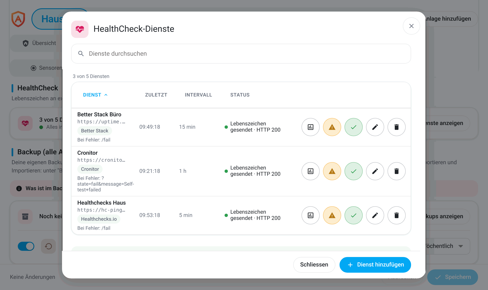</p>

- **Protokoll (seit 1.68.0):** Der runde Knopf "Protokoll" öffnet das Protokoll eines Dienstes, aufgebaut wie die Sensoransicht. Oben das getönte Herz, der Name als Auswahl zum Wechseln auf einen anderen Dienst (nur bei mehr als einem Dienst; bei einem einzigen steht der Name ohne Pfeil) (je mit einem Punkt in der Farbe seines Zustands und "in Ordnung seit …" oder "gescheitert seit …"), darunter Rechner, erkannter Dienst und Intervall, rechts der Zustand und die runden Knöpfe der Liste "Fehler senden", "Lebenszeichen senden" (seit 1.69.0; danach lädt das Protokoll neu) und der Stift (öffnet das Formular). Drei Kacheln: **Verlauf** (Zustand seit wann), **Antwortzeit** (des letzten Aufrufs) und **Dienst**. Der Zeitraum reicht von 3 Stunden bis 1 Jahr (3 Std., 12 Std., 1 Tag, 7 Tage, 30 Tage, 6 Monate, 1 Jahr; auf dem Handy in einer Zeile, auf sehr schmalen Handys in zwei). Der Verlauf bis 1 Tag ist ein "Herzschlag": je Aufruf oder Abschnitt ein Balken, seine Höhe die Antwortzeit, seine Farbe das Ergebnis (Lebenszeichen grün, Fehler gemeldet orange, gescheitert rot, Test blau, keine Daten grau, weil Home Assistant aus war), darunter ein Band, das den Zustand ohne Unterbruch zeigt und jeden Fehler und Test markiert. 7 Tage zeigen ein grosses Raster aus Tagen und Stunden (seit 1.76.0: eine Zeile je Tag mit Beschriftung, quadratische Zellen, das schlechteste Ergebnis jeder Stunde), 30 Tage dasselbe Raster aus Tagen und Stunden wie bei den Bewegungsmeldern (das schlechteste Ergebnis jeder Stunde), 6 Monate und 1 Jahr ein Raster aus Monaten und Tagen (eine Zeile je Monat, eine Zelle je Tag: grün alle angekommen, orange Fehler gemeldet, rot gescheitert, grau eine Lücke von mehr als 30 Minuten ohne Daten, ein Test als blauer Punkt), darunter die Zahl der Tage mit Ausfall, mit Fehlermeldung und mit Lücke. Kennzahlen: erfolgreich (in Prozent), Lebenszeichen, gescheitert, Fehler gemeldet, Antwortzeit im Mittel. **Antwortzeit** zeigt eine Linie mit den Zonen schnell (bis 300 ms), langsam und sehr langsam (über 1 s) und eine gestrichelte rote Marke bei jedem gescheiterten Aufruf, mit den Kennzahlen aktuell, im Mittel, langsamster Aufruf und ohne Antwort; über 6 Monate und 1 Jahr das Mittel je Tag und eine Marke an jedem Tag mit gescheitertem Aufruf. **Dienst** nennt Name, erkannten Dienst, Ping-URL, Fehler-Zusatz, Aufruf bei Fehler, Intervall, Zustand, letzten Aufruf und seit wann das Protokoll aufzeichnet, je mit Knopf zum Kopieren. Darunter zwei Reiter: **Ereignisse** (Standard: gescheitert, Fehler gemeldet wegen des Selbsttests mit der Zahl der Probleme, Test, wieder in Ordnung, erstes Lebenszeichen nach einem Start; aufeinanderfolgende Fehler sind ein Ereignis mit ihrer Anzahl) und **Alle Aufrufe** (jeder Aufruf mit Ergebnis, Antwortzeit und Auslöser: Takt, Selbsttest, Test, Start, Gespeichert). Beide folgen genau dem oben gewählten Zeitraum, und die Zahl am Reiter ist die Zahl der Liste. Einzelne Aufrufe bleiben 24 Stunden; ab 7 Tagen zeigt die Liste "Alle Aufrufe" die letzten 24 Stunden und sagt das, ältere stehen zusammengefasst in Grafik und Kennzahlen. Ab 6 Monaten zeigen Grafik, Kennzahlen und Liste ganze Tage. Suche und Sortierung nach jeder Spalte, der Tabellenkopf bleibt stehen. Aufbewahrt: einzelne Aufrufe 24 Stunden, Stundenwerte 30 Tage, Tageswerte und Ereignisse ein Jahr (höchstens 1000 Ereignisse je Dienst); bei 5 Minuten Intervall üblich rund 60 KB je Dienst, höchstens rund 160 KB. Geschrieben wird spätestens 10 Minuten nach einem Aufruf und beim Beenden von Home Assistant; ein Absturz kostet höchstens die letzten Minuten. Das Protokoll ist Laufzeit: nicht im Backup, nie mit der URL, und es verschwindet mit dem Dienst. Es beginnt mit dem Update auf 1.68.0.

<p align="center">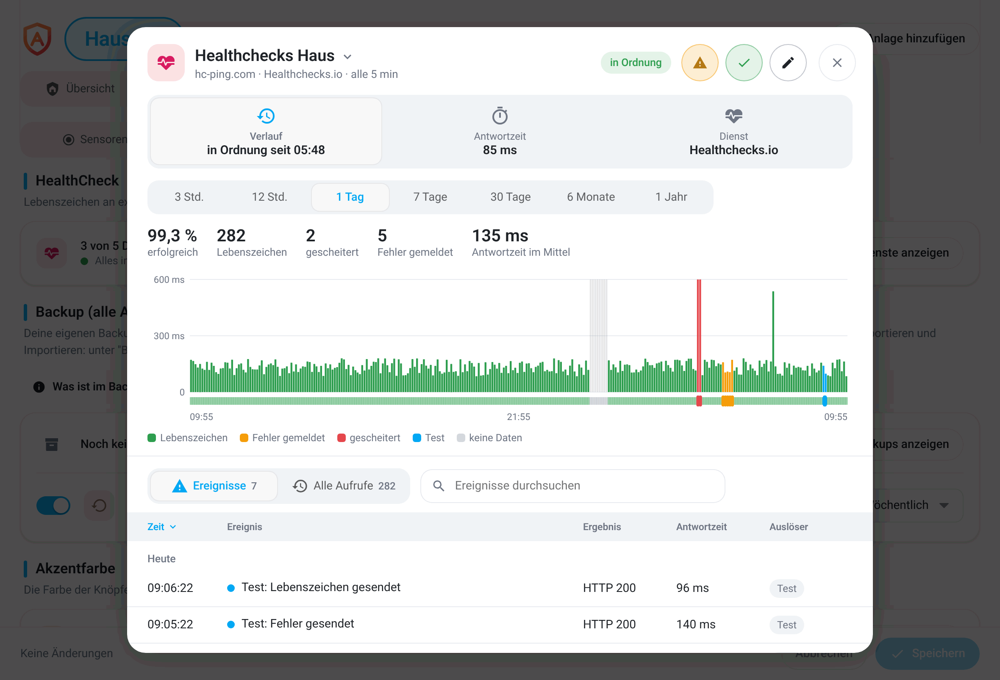</p>

- **Wenn ein Lebenszeichen nicht hinausgeht:** Es wird ein Problem des Selbsttests ("Lebenszeichen "…" gescheitert" mit dem Namen, dem Rechner und dem Grund; "Öffnen" führt zur Liste) und verschwindet mit dem nächsten Lebenszeichen, das klappt, oder wenn du den Dienst entfernst. Für das nächste Lebenszeichen zählt es nicht als Fehler (es liesse sich auf demselben Weg nicht melden).
- **Sicherheit:** Die Ping-URL steht ganz im Panel und im Backup, weil sie deine Einstellung ist. Log, Meldungen und Probleme des Selbsttests nennen nur den Rechnernamen (zum Beispiel `hc-ping.com`). Ein Lebenszeichen wartet höchstens 10 Sekunden und hält nie einen Alarm, ein Speichern oder den Selbsttest auf.

### Überwachung

Neben dem Alarm kann Alarmageddon beobachten, was nichts mit Einbrechern zu tun hat: einen Kühlschrank, der zu warm wird, einen feuchten Keller, schlechte Luft, eine offen gelassene Kühlschranktür. Eingeschaltet wird sie unter Konfiguration › Anlage › Modi (standardmässig aus); dann lassen sich Messwerte (Temperatur, Luftfeuchtigkeit, CO2 ...) in der Sensorliste hinzufügen (dort ausgegraut: keine Zone, nie immer aktiv, keine Eingangsverzögerung), und unter Konfiguration › Aktionen erscheint der Reiter "Überwachung" neben den Modi.

Jede Regel ist ein Kapitel mit ihrem Ablauf: "Ausserhalb der Grenzen" (orange) und "Wieder in Ordnung" (grün), gebaut aus denselben Schritten wie die Alarmaktionen, aber nur Push-Meldung, Gerät schalten und Warten. Eine Regel hat eine Bedingung (Messwert über, unter oder ausserhalb von Grenzen, Gerätezustand, Uhrzeit, "Anlage ist scharf", verbunden mit Und/Oder), eine Dauer, die die Bedingung gelten muss (zum Beispiel 30 Minuten), eine Rückkehr-Spanne gegen Flattern um die Grenze und auf Wunsch eine Erinnerung alle paar Stunden. Texte kennen die Platzhalter `{rule}`, `{sensor}`, `{value}`, `{unit}`, `{limit}`, `{since}` und `{name}`; ohne eigenen Text geht ein passender Standardtext an die gewählten Empfänger oder an die Empfänger der Wartungsmeldungen.

<p align="center">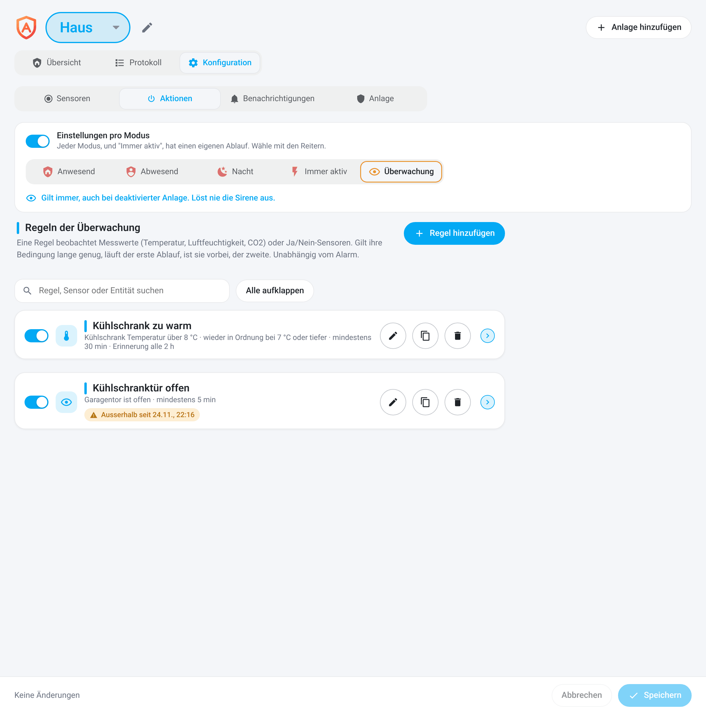</p>

Jeder Schritt einer Regel hat einen Play-Knopf, der nur diesen Schritt einmal ausführt (eine Push-Meldung mit dem Titel "Test: ..." oder das Gerät wird geschaltet), auch bevor die Regel gespeichert ist; "Warten" gibt es nicht zu testen.

Die Überwachung läuft immer, auch bei deaktivierter Anlage, und löst nie die Sirene oder den Alarm aus (Feuer und Wasser bleiben bei "Immer aktiv"). Ein Sensor, der nicht antwortet, zählt nie: Er löst keine Regel aus und beendet auch keine, ein Funkabriss meldet also nie "wieder in Ordnung". Eine laufende Regel meldet sich nach einem Neustart nicht noch einmal.

Die Messwert-Sensoren der Überwachung (Temperatur, Luftfeuchtigkeit, CO2) stehen auch in der Übersicht des Panels mit ihrem Wert, und ein Tipp öffnet dieselbe Ansicht wie bei jedem Sensor: der Reiter "Verlauf" mit dem Werteverlauf, Batterie, Empfang und Gerät. Unter der Grafik stehen nur die Ereignisse der Überwachung ("Ausserhalb der Grenzen", "Wieder in Ordnung"), nie die einzelnen Werte. Jede Grenze einer Regel der Überwachung mit diesem Sensor steht als gestrichelte Linie in der Grafik; die Grafik reicht bis zu ihr, auch wenn sie weit weg von den Werten liegt (die Kurve wird dann flacher). Bei jedem Sensor, der in der Überwachung vorkommt (Messwerte und Ja/Nein-Sensoren in einer Regel der Überwachung), stehen über der Liste zwei Reiter: "Ereignisse" und "Regeln". "Regeln" zeigt die Regeln der Überwachung mit diesem Sensor aus allen Anlagen, mit der Bedingung in Worten und ihrem Zustand ("Aktiv", "Aus", "Ausserhalb", wenn sie gerade ausgelöst ist). Beide Listen haben ein Suchfeld und lassen sich nach jeder Spalte sortieren (Tipp auf den Spaltentitel; nach Zeit sortiert bleibt eine Zeile je Tag). Der Pfeil einer Regel führt zu ihr unter Konfiguration › Aktionen › Überwachung, aufgeklappt und kurz markiert; mit offenen Änderungen in einer anderen Anlage fragt das Panel vorher. Der Editor einer Regel erklärt die Rückkehr-Spanne mit deinen eigenen Werten: bei welchem Wert die Regel auslöst, ab welchem sie wieder in Ordnung ist und wo die Pufferzone liegt.

### Bei einem Alarm

Ein Alarm ist nicht zu übersehen: ein rotes Band mit dem Sensor, der ausgelöst hat, und den Knöpfen "Quittieren" (der Alarm endet, die Anlage bleibt scharf) und "Deaktivieren". Die Kachel der Anlage nennt, seit wann der Alarm läuft, was ihn ausgelöst hat und wer wann scharf geschaltet hat. Dieselben Knöpfe stehen in der Push-Meldung auf dem Sperrbildschirm.

<p align="center">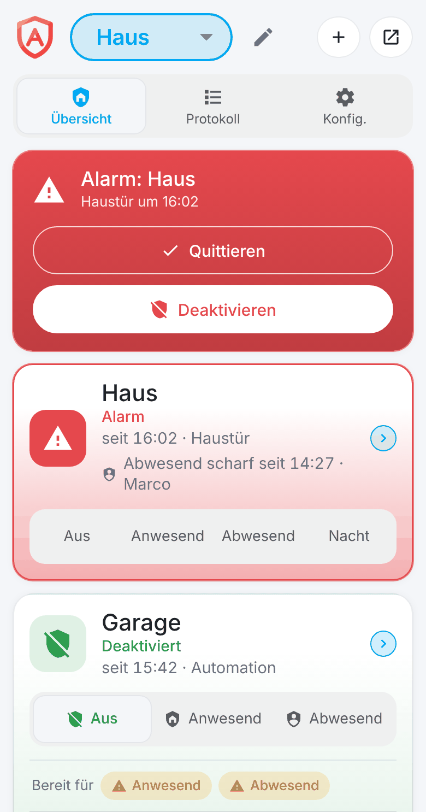</p>

**Roter Kreis nach einem Alarm (seit 1.82.0):** nach einem echten Alarm (einem, den das Protokoll aufzeichnet) erscheint im Kopf neben dem Stift ein roter Kreis mit Alarmzeichen, rundherum derselbe Komet mit demselben Aufblitzen wie beim Zauberstab (ohne Stab). Mit dem Knopf des Assistenten sind beide zu sehen, und die Kometen laufen genau gleichzeitig. Er gehört zur ganzen Anlage und bleibt, bis ihn jemand antippt (Protokoll › Alarme öffnet sich mit diesem Alarm aufgeklappt) oder den Alarm im Protokoll von Hand öffnet. Im aufgeklappten Alarm wechselt der Knopf "Als ungelesen markieren" / "Als gelesen markieren" den Zustand; ungelesene Alarme bringen den Kreis als Erinnerung zurück und tragen einen langsam pulsierenden roten Punkt vor dem Titel.

**Roter Kreis nach einem Alarm (seit 1.82.0):** nach einem echten Alarm (einem, den das Protokoll aufzeichnet) erscheint im Kopf neben dem Stift ein roter Kreis mit Alarmzeichen, rundherum derselbe Komet mit demselben Aufblitzen wie beim Zauberstab (ohne Stab). Mit dem Knopf des Assistenten sind beide zu sehen, und die Kometen laufen genau gleichzeitig. Er gehört zur ganzen Anlage und bleibt, bis ihn jemand antippt (Protokoll › Alarme öffnet sich mit diesem Alarm aufgeklappt) oder den Alarm im Protokoll von Hand öffnet. Im aufgeklappten Alarm wechselt der Knopf "Als ungelesen markieren" / "Als gelesen markieren" den Zustand; ungelesene Alarme bringen den Kreis als Erinnerung zurück und tragen einen langsam pulsierenden roten Punkt vor dem Titel.

### Protokoll und Zeitachse des Alarms

Jeder Alarm wird vom ersten Auslösen bis zum Quittieren aufgezeichnet: welcher Sensor wann angesprochen hat, welche Schritte liefen, welche Meldungen hinausgingen. Alle anderen Ereignisse (scharf, deaktiviert, Routinen, Sensorausfälle) stehen im zweiten Reiter, mit Filter nach Zeitraum und CSV-Export. Beides bleibt ein Jahr; einen einzelnen Alarm kannst du löschen.

Ein Alarm, wie er abläuft, mit erfundenen Daten (links das Handy, rechts der Computer):

<p align="center"> </p>

<p align="center">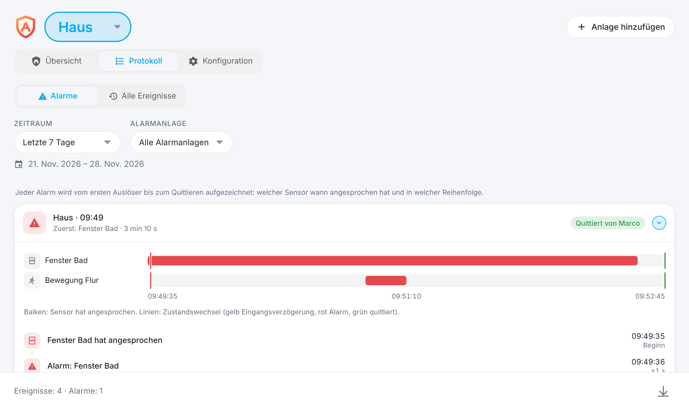</p>

### Dashboard-Karten

Das Bedienteil und die Info-Kachel des Seitenpanels gibt es auch als Karten für jedes Dashboard: "Karte hinzufügen" › "Alarmageddon". Jede Person, die das Dashboard sehen darf, kann die Karte benutzen, nicht nur Administratoren. Wo ein Code programmiert ist, wird er verlangt; ob "Quittieren" ihn braucht, bestimmt der Administrator unter Konfiguration › Anlage. Wie die Statuskachel des Panels zeigt die Statuskarte den Selbsttest und, sobald HealthCheck-Dienste eingerichtet sind, daneben die Dienste (alle in Ordnung, Fehler gemeldet, gescheitert); die Zahlen liest sie aus der Statusentität (Attribute `healthcheck`, `healthcheck_ok`, `healthcheck_report`, `healthcheck_fail`, nie eine Adresse).

<p align="center">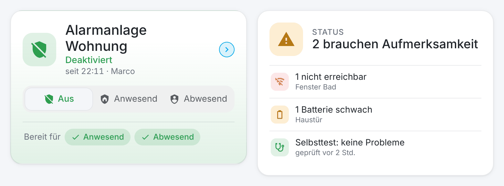</p>

Erscheint die Karte nicht im Auswahldialog: Home Assistant nach dem Update neu starten, die Seite neu laden (Strg+Shift+R; in der App: Einstellungen › Fehlerbehebung › Frontend-Cache zurücksetzen) oder eine Karte von Hand mit `type: custom:alarmageddon-card` und `entity: alarm_control_panel.<name>` einfügen. Die Meldung "Das Custom-Element existiert nicht" heisst, dass die Kartendatei noch nicht geladen wurde.

### Mehr

- **Routinen:** zu festen Zeiten an gewählten Wochentagen scharf schalten oder deaktivieren, oder wenn ein Gerät etwas tut, zum Beispiel wenn das Smart Lock abschliesst. Mehrere Bedingungen lassen sich mit "und" und "oder" verbinden, auch in Gruppen. Jede Routine gilt nur in den Zuständen der Anlage, die du wählst.
- **Codes pro Person:** jede Person bekommt ihren eigenen Code; das Protokoll zeigt, wer scharf geschaltet und deaktiviert hat.
- **Modi:** "Anwesend", "Abwesend" und "Nacht", jeder ein- und ausschaltbar, jeder mit eigener Zone, eigenen Verzögerungen und Aktionen.
- **Bestätigung durch zwei Sensoren:** ein Bewegungsmelder kann einen zweiten Sensor verlangen, bevor er auslöst, gegen Fehlalarme.
- **Backup:** alle Einstellungen als Datei oder in der Integration abgelegt, nie mit Codes. Ein automatisches Backup (täglich, wöchentlich oder monatlich; standardmässig an und wöchentlich) behält die letzten 5 (1 bis 50 wählbar), zusätzlich zu deinen 10 eigenen.
- **Anlage löschen (seit 1.82.0):** jede Anlage nimmt ihre eigenen Daten und die gemerkten letzten Änderungen ihrer Sensoren mit. Mit der letzten Anlage gehen auch die gemeinsamen Verläufe (Protokoll der HealthCheck-Dienste, Wartungsstand, Sensorstatistik, Empfangsverlauf); Backups, Einstellungen und eigene Töne bleiben, damit nach einer Neuinstallation nichts verloren ist. Reste andernorts gelöschter Anlagen (zum Beispiel in Home Assistant selbst): 5 Minuten nach jedem Start und danach täglich räumt die Integration auch deren Ablagen und gemerkte Sensoränderungen auf. Jede vorhandene Anlage zählt, auch eine deaktivierte; Backups, Einstellungen und eigene Töne bleiben unberührt.
- **Mehrere Anlagen:** Haus und Garage, jede als eigenes Gerät. "Anlage hinzufügen" oben im Panel zeigt Gerät und Alarm-Entität, bevor etwas angelegt wird; der Knopf neben der Entitäts-ID kopiert sie (für Automationen und Dashboards). Die neue Anlage öffnet danach den Einrichtungsassistenten.
- **Zurück zur Übersicht:** das Panel merkt sich 30 Minuten lang, wo du warst; danach startet es wieder auf der Übersicht.

## Sicherheitsmechanismen

Eine Alarmanlage muss funktionieren, wenn etwas anderes es nicht tut. Diese Mechanismen sind eingebaut und werden bei jeder Änderung von Tests geprüft.

<p align="center"></p>

| Mechanismus | Was er sicherstellt |
| --- | --- |
| Im Zweifel alarmieren | Eine Eingangsverzögerung, die während eines Neustarts von Home Assistant abgelaufen ist, wird zum Alarm, mit Alarmaktionen, Meldung und Aufzeichnung. Während Eingangsverzögerung und Alarm wird Scharfschalten abgelehnt: nur Deaktivieren führt heraus |
| Sicher beim Neustart | Zustand, Verzögerungen und ein laufender Alarm gehen nach einem Neustart weiter; die Alarmaktionen setzen beim erreichten Schritt fort oder beginnen von vorn, wenn kein Ablauf abgelegt war. Jeder Wechsel des Zustands wird sofort geschrieben, damit auch nach einem Absturz oder Stromausfall der letzte Stand gilt |
| Codes | 4 bis 8 Ziffern, nur als Hash mit Salz gespeichert, nie angezeigt, nie in einem Backup oder im Log. Fünf falsche Codes sperren die Anlage für eine Minute, auch für den richtigen Code; gleichzeitige Versuche werden einzeln nacheinander geprüft |
| Nur Administratoren | Das Seitenpanel und jeder seiner Befehle verlangen Administratorrechte. Die Dashboard-Karten nutzen nur Entitäten und Dienste, mit den Codes, die Home Assistant prüft |
| Knöpfe in der Alarmmeldung | "Deaktivieren" und "Alarmton stumm" sind standardmässig aus, "Quittieren" ist an. Sie wirken nur, solange der Alarm läuft, und nur vom Handy eines konfigurierten Alarm-Empfängers |
| Nichts hält die Sirene auf | Ein Gerät, das nicht antwortet, wird nach 10 Sekunden übergangen, auf eine Push-Meldung wird nie gewartet, und ein scheiternder Schritt, ein scheiterndes Protokoll, eine scheiternde Aufzeichnung oder Meldung stoppt den Rest nie |
| Wächter | Die Alarmaktionen stehen als Ganzes unter Aufsicht: der erste Schritt beginnt innert 8 Sekunden, kein Schritt verzögert den nächsten über seine Grenze hinaus, und ein abgebrochener Ablauf macht mit dem nächsten Schritt weiter. Eingriffe stehen in der Zeitachse des Alarms |
| Du bestimmst, wie lange die Sirene läuft | Im Code steht keine feste Dauer. Du stellst sie im Ablauf ein ("Warten" zwischen Ein und Aus oder eine Dauer beim Ton, bis zu einer Stunde je Schritt). Sie gilt genau und zählt ab dem ersten Start, auch über einen Neustart hinweg |
| Selbsttest | Prüft regelmässig, ob alles, was die Anlagen brauchen, da und erreichbar ist, und hält fest, was im Betrieb scheiterte; er liest nur und hält nie einen Alarm auf |
| HealthCheck | Lebenszeichen an einen Dienst draussen: Fällt Home Assistant aus oder verliert es das Internet, meldet sich der Dienst; Probleme des Selbsttests kommen dort ebenfalls an. Ein Lebenszeichen wartet höchstens 10 Sekunden und hält nie etwas auf |
| Sensoren, die ausfallen | Ein Sensor, der im scharfen Zustand nicht mehr erreichbar ist, wird sofort gemeldet oder löst mit der Option "Ausfall gilt als Alarm" den Alarm aus. Schwache Batterien werden gemeldet, bevor sie leer sind |
| Getestet | Über 1600 automatische Tests gegen ein echtes Home Assistant (in zwei Versionen, eine ältere und eine aktuelle), rund 8700 Prüfungen der Oberfläche auf Computer und Handy und eine Mutationsprobe, die jede von 410 Schutzmassnahmen ausbaut und verlangt, dass ein Test scheitert |

### Grenzen

Alarmageddon ist keine zertifizierte Alarmanlage. Bitte beachte:

- Fällt Home Assistant, der Strom, das Netzwerk oder der Funk-Koordinator aus, gibt es keinen Alarm. Für kritische Einsätze hilft eine Sirene mit eigenem Akku; ein HealthCheck-Dienst meldet wenigstens, dass Home Assistant verstummt ist.
- Wie lange eine Sirene laufen darf, ist von Ort zu Ort verschieden geregelt. Kläre, was bei dir gilt, und stelle die Dauer in den Alarmaktionen ein; am sichersten ist eine Sirene mit eigener Zeitbegrenzung.
- Ein Ton "bis zum Deaktivieren" und eine Sirene ohne Schritt "aus" laufen, bis jemand deaktiviert. Das wählst du im Ablauf.

## Apple HomeKit

1. Die Alarm-Entität in die HomeKit Bridge von Home Assistant aufnehmen (Domäne `alarm_control_panel` oder die Entität einschliessen).
2. Apple Home zeigt "Aus" und die eingeschalteten Modi.
3. Mit Code: HomeKit fragt nicht danach. Trage ihn in der Konfiguration der HomeKit Bridge ein (`entity_config` → `code`) oder als Standardcode in den Einstellungen der Entität.

## Entitäten

| Entität | Inhalt |
| --- | --- |
| `alarm_control_panel.<name>` | Die Anlage. Attribute: `arm_mode`, `triggered_by`, `bypassed_sensors`, `deadline`, `changed_by`, `armed_at`, `armed_by`, `state_since` (seit wann sie in ihrem Zustand ist; übersteht einen Neustart) |
| `binary_sensor.<name>_zone_<modus>` | An, wenn ein Sensor der Zone dieses Modus offen ist |
| "Bereit zum Scharfschalten" je Modus | An, wenn kein offener Sensor das Scharfschalten in diesem Modus verhindert. Attribut: `blocking_sensors` |
| `sensor.<name>_status` | Zahl der offenen Probleme: Alarm, nicht erreichbare Sensoren, schwache Batterien, Probleme des Selbsttests. Attribute: `alarm`, `offline`, `low_battery`, `battery_threshold`, `selftest`, `selftest_last` |
| `binary_sensor.<name>_selbsttest` | Selbsttest (Problem, Diagnose): ein, solange der Selbsttest etwas gefunden hat, das diese Anlage betrifft, vor der ersten Prüfung unbekannt. Attribute: `last_check`, `count`, `problems` (die ersten 20, nur Art und ID) |

Zonen- und "Bereit"-Entitäten gibt es nur für die eingeschalteten Modi.

Dienst `alarmageddon.acknowledge` (Ziel: die Alarm-Entität, optional `code`): stellt einen laufenden Alarm ab; für jede Person nutzbar, von der Dashboard-Karte verwendet.

## Gut zu wissen

Details für alle, die es genau wissen wollen.

### So läuft ein Alarm ab

<p align="center"></p>

- Nur ein echter Wechsel von zu auf offen löst aus. Ein Sensor, der aus "nicht verfügbar" offen zurückkommt, löst nicht aus.
- Ein Sensor mit Eingangsverzögerung (zum Beispiel die Haustür) startet die Eingangsverzögerung; jeder andere Sensor löst sofort aus. Ein Eingangssensor kann eine eigene Verzögerung haben (Sensor-Optionen), sonst gilt die der Anlage. Ein zweiter Eingangssensor verlängert die Verzögerung nicht.
- Sensoren mit "Immer aktiv" (Rauch, Wasser, Gas) lösen in jedem Zustand aus, auch deaktiviert.
- Der Alarm bleibt, bis jemand deaktiviert. Wie lange Sirene, Licht und Ton laufen, steht in den Alarmaktionen.
- Offene Sensoren verhindern das Scharfschalten, ausser sie dürfen offen sein oder werden bis zum nächsten Deaktivieren umgangen.

### Zahlen und Grenzen

| Was | Wert |
| --- | --- |
| Ausgangsverzögerung | Standard 60 s für "Abwesend", keine für "Anwesend" und "Nacht"; bis 3600 s je Modus |
| Eingangsverzögerung | Standard 30 s, auf Wunsch je Modus und je Sensor |
| Bestätigungsfenster für den zweiten Sensor | Standard 60 s |
| Falsche Codes | Fünf, dann 60 s gesperrt |
| Ablage der Codes | PBKDF2-SHA256 mit 120 000 Runden und einem Salz je Code |
| Gerät antwortet nicht | Nächster Schritt nach 10 s |
| Erster Schritt nach dem Auslösen | Höchstens 8 s (Wächter) |
| Warten und Dauer des Tons | 0 bis 3600 s je Schritt, bis 40 Schritte je Ablauf |
| Aktions-Gruppe | 1 bis 100 Durchläufe oder 1 bis 3600 s, höchstens 10 Aktionen, mindestens 1 s je Runde |
| Test der Alarmaktionen | Endet spätestens nach 60 s |
| Batterie schwach, Sensor nicht erreichbar | Unter 20 % bei 3 Prüfungen in Folge (alle 15 Minuten), nach 60 Minuten (alles einstellbar) |
| HealthCheck | Bis zu 5 Dienste, Intervall 1 Minute bis 24 Stunden, höchstens 10 s je Aufruf, bei einem Wechsel des Selbsttests höchstens einmal je Minute und Dienst; Protokoll: einzelne Aufrufe 24 Stunden, Stundenwerte 30 Tage, Tageswerte und Ereignisse ein Jahr (höchstens 1000 Ereignisse je Dienst) |
| Aufbewahrt je Anlage | Ereignisse und Alarme ein Jahr (höchstens 5000 Ereignisse und 200 Alarme mit je 300 Einträgen, mit Aktionen und Meldungen höchstens 600); insgesamt 10 Backups |

### Optionen pro Sensor

- **Immer aktiv:** lässt sich als Ganzes abschalten (Konfiguration › Anlage). Löst in jedem Zustand aus, scharf wie deaktiviert, und zwar sofort (Rauch, Wasser, Gas), mit den Optionen aus dem Reiter "Immer aktiv". Steht der Sensor zugleich in der Zone eines Modus, zählt nur dieser Modus, solange die Anlage darin scharf ist (seine Einstellungen und seine Aktionen); mit ausgeschaltetem Schalter "Scharf in <Modus>: nur <Modus> zählt" gilt "Immer aktiv" zusätzlich: der Sensor löst sofort aus, und beide Abläufe der Alarmaktionen laufen. Bei deaktivierter Anlage und in Modi, die den Sensor nicht enthalten, laufen die Aktionen von "Immer aktiv".
- **Darf beim Scharfschalten offen sein:** ein offener Sensor verhindert das Scharfschalten nicht und löst aus, nachdem er geschlossen und wieder geöffnet wurde.
- **Beim Scharfschalten umgehen:** ein offener Sensor wird bis zum nächsten Deaktivieren ignoriert.
- **Scharf, sobald geschlossen:** wird dieser Sensor in der Ausgangsverzögerung geschlossen (die Haustür hinter dir), ist die Anlage sofort scharf, statt das Ende der Verzögerung abzuwarten.
- **Ausfall gilt als Alarm:** ein nicht erreichbarer Sensor löst im scharfen Zustand den Alarm aus.
- **Braucht einen zweiten Sensor:** löst nur aus, wenn ein anderer Sensor mit dieser Option innerhalb des Bestätigungsfensters anspricht.
- **Stiller Alarm:** sendet eine Meldung, statt den Alarm auszulösen, höchstens einmal pro Minute.

### Alarmaktionen und Benachrichtigungen im Detail

- **HealthCheck melden (seit 1.77.0):** ersetzt den Alarm-Zusatz der Dienste. Du wählst einen Dienst aus der Liste der eingerichteten (bis es einen gibt, steht die Aktion in der Auswahl ausgegraut da, mit dem Hinweis "Kein Dienst eingerichtet"), und der **Zusatz** ist das Einzige, das du bearbeitest ("/…" verlängert den Pfad, "?…" oder "&…" setzt Parameter). Bei einem erkannten Dienst wird der Vorschlag eingesetzt, solange du das Feld nicht berührt hast, sonst steht "Vorschlag übernehmen" daneben; darunter steht der ganze Aufruf (Adresse des Dienstes mit deinem Zusatz) als schlichter Text, nicht als Feld, mit einem Knopf zum Kopieren. In der Auswahl einer neuen Aktion steht "HealthCheck melden" ganz unten. Im Ablauf des Alarms hat die Aktion unter "Bis der Alarm endet" zwei weitere Schalter, bei einer neuen Aktion beide an: "Meldung wiederholen" (im Abstand der Lebenszeichen des Dienstes erneut gesendet, nicht einstellbar, beim Anbieter ändert sich nichts) und "Lebenszeichen pausieren" (die normalen Lebenszeichen dieses Dienstes bleiben aus, damit sie die Meldung nicht überschreiben; die Fehlermeldung des Selbsttests geht weiter hinaus). Beides endet mit Deaktivieren oder Quittieren, gilt nie in einem Test und geht nach einem Neustart mitten im Alarm weiter. Ältere Aktionen haben beide aus. Ein Link "HealthCheck-Dienste öffnen" führt zu den Diensten, ohne die Aktion zu verlassen. Der Play-Knopf der Karte sendet die Meldung einmal (als Test, im Protokoll des Dienstes als solcher zu sehen); der Aufruf ist eine eigene Aufgabe, wartet nie und hält den Alarm nie auf. Weil jede Aktion ihren eigenen Zusatz hat, lässt sich je Alarmart etwas anderes melden, bei den Aktionen nach dem Quittieren oder beim Deaktivieren zum Beispiel das Lebenszeichen, dass der Alarm vorbei ist. Wird der Dienst später gelöscht, sagt die Karte "Dienst fehlt" und der Selbsttest meldet es. Alarm-Zusätze der Dienste aus 1.73.0 bis 1.76.x gibt es nicht mehr: richte stattdessen die Aktionen ein.

- **Aktions-Gruppe:** eine Gruppe ist ein Rahmen in der Farbe ihres Bereichs; Aktionen kommen über das Plus in der Gruppe hinein oder durch Ziehen, und ebenso wieder heraus (mit der Tastatur: Pfeiltasten am Griff). Sie wiederholt ihre Aktionen eine **Anzahl** Durchläufe (1 bis 100), für eine **Dauer** (1 bis 3600 s) oder **bis deaktiviert** (nur beim Alarm; endet mit Deaktivieren, Quittieren oder "Alarmton stumm"). Jede Runde dauert mindestens 1 Sekunde. Bei "Dauer" beginnt eine Runde nur, wenn sie noch ganz in die Zeit passt: Die Gruppe läuft nie länger als eingestellt und endet nie mitten in einer Runde; die erste Runde läuft immer ganz. "Warten, bis die Aktion beendet ist" gilt wie bei den anderen Aktionen (Standard aus: die folgenden Aktionen starten sofort); auf "bis deaktiviert" lässt sich nicht warten. In einer Gruppe gibt es keine Gruppe und kein "Quittieren"; höchstens 10 Aktionen, sie zählen zur Grenze von 40 je Liste. "Nach einer Zeit rückgängig machen" (Gerät schalten) gilt in einer Gruppe je Gerät nur einmal, und jede Runde beginnt die Zeit neu: Ist die Runde kürzer als die Zeit, schaltet das Gerät erst nach der letzten Runde zurück. Ziehst du eine Gruppe in einen anderen Bereich, fallen nach einer Rückfrage die Aktionen weg, die es dort nicht gibt. Ein dünner gestrichelter Bogen links neben den Aktionen führt vom letzten Schritt zurück zum ersten: er zeigt, dass sich diese Schritte wiederholen. Nach einem Neustart mitten im Alarm läuft eine Gruppe "bis deaktiviert" wieder an. Schaltet eine Gruppe ein Gerät und wird mitten in der Runde deaktiviert, kehrt es nur mit "Rückgängig" in seinen vorherigen Zustand zurück.
- **Aktion verschieben oder kopieren (seit 1.85.0):** jede Aktion hat zwischen "Duplizieren" und "Löschen" einen runden Knopf mit dem Symbol Blatt mit Pfeil ("Duplizieren" bleibt und kopiert direkt unter die Aktion). Er öffnet ein Fenster: oben die Reiter der Modi (nur mit "Einstellungen pro Modus"), darunter ein Baum aller Phasen des Ablaufs in der Reihenfolge des Ablaufs (Ausgangsverzögerung, Scharf, Stiller Alarm, Eingangsverzögerung, Alarm beginnt, Alarm endet, Deaktiviert; Phasen, die es im Modus nicht gibt, fehlen). Gezeigt werden nur die Stellen, an denen die Aktion erlaubt ist (dieselben Regeln wie beim Ziehen; eine Gruppe steht als eigener Zweig da, nie eine Gruppe in einer Gruppe). Die gewählte Phase klappt auf und zeigt ihre Aktionen mit Einfügepunkten dazwischen: du wählst die genaue Stelle ("Hier einfügen"); die Stellen direkt neben der Aktion selbst gelten nur für das Kopieren. Unten steht das gewählte Ziel in Worten, dann **Kopieren** (die Aktion bleibt, wo sie ist) oder **Verschieben**. Beides ändert nur den Entwurf der Seite: danach springt die Seite zur Aktion an ihrem neuen Ort (auch in einen anderen Modus), hebt sie kurz hervor, und eine Meldung nennt das Ziel und bietet **Rückgängig** an (solange sonst nichts geändert wurde). Eine volle Liste nimmt keine weitere Aktion auf; wandert eine Gruppe in einen anderen Bereich, fragt die Seite vorher, wenn einige ihrer Aktionen dort nicht gelten.
- **Befunde des Selbsttests an den Aktionen (seit 1.86.0):** findet der Selbsttest ein Problem mit einer Aktion (eine Entität fehlt oder ist nicht erreichbar, ein Dienst, Lautsprecher oder Empfänger ist weg), trägt die Karte dieser Aktion ein **grosses rotes Ausrufezeichen** an der Ecke, einen roten Rahmen und eine Zeile mit dem Befund ("Sirene Flur fehlt", "Lautsprecher nicht erreichbar"); ein Tipp auf die Zeile öffnet genau diesen Befund im Fenster des Selbsttests. Befunde, die den Alarm nicht gefährden können (nicht im Ablauf des Alarms), sind orange. Eine Gruppe zeigt die Zahl der Befunde ihrer Aktionen und markiert die Karten darin. Der Reiter eines Modus mit Befunden trägt ebenfalls ein Ausrufezeichen, so findest du den Modus, ohne alle durchzuklicken. Nach "Jetzt prüfen" oder der nächsten Prüfung folgen die Marken dem neuen Stand; Fehler während eines Laufs (ohne Stelle im Ablauf) stehen nur im Selbsttest.

<p align="center">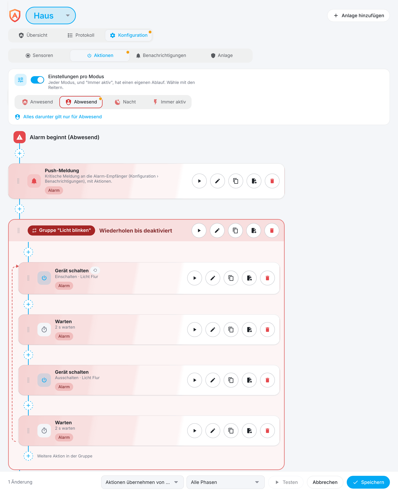</p>

- **Schritte laufen weiter:** standardmässig startet der nächste Schritt sofort, die Aktionen laufen so schnell wie möglich nacheinander durch. Mit "Warten, bis die Aktion beendet ist" startet der nächste erst, wenn dieser fertig ist; der Schritt trägt dann eine Pille. Auf einen Ton "bis zum Deaktivieren" lässt sich nicht warten. Abläufe aus früheren Versionen verhalten sich wie bisher.
- **Vier Arten von Tönen, jede mit eigenen Klängen:** der **Alarmton** (der Ton des Alarms, fünf Klänge von Sirene bis Jaulton; ihn stoppt der Knopf "Alarmton stumm" der Push-Meldung), der **Voralarm** (ein leiser Warnton vor dem Alarmton, fünf Klänge wie Gong, Warnung oder langsames Piepsen; danach folgt der nächste Schritt) der **Aktivierungston** (kurz, dezent oder freundlich, sieben Klänge von Piepsen bis Dreiklang) und der **Deaktivierungston** (sein Gegenstück, fünf fallende Klänge wie ein absteigender Dreiklang oder eine tiefe Glocke). Jeder lässt sich im Panel probehören. Ein Ton spielt für seine ganze Dauer am Stück: der Lautsprecher wird einmal gestartet, der Ton beginnt und endet weich. Die Lautstärke stellst du für alle Medienplayer gemeinsam ein oder für jeden einzeln, zum Beispiel leiser im Schlafzimmer.
- **Feste Meldungen:** "Scharf geschaltet" (unter "Anlage scharf geschaltet"), "Stiller Alarm" (im Kapitel "Bei einem stillen Alarm"), "Eingangsverzögerung" (unter "Eingangsverzögerung läuft"), "Deaktiviert" (unter "Anlage deaktiviert") und die Abschlussmeldung (unter "Alarm endet") sind feste Elemente des Ablaufs, je Alarmanlage und mit "Einstellungen pro Modus" je Modus; im Reiter "Immer aktiv" gibt es nur "Stiller Alarm". Der Schalter auf der Karte schaltet die Meldung ein und aus, Play sendet eine Testmeldung mit den Werten der Karte (auch ungespeichert; ausgeschaltet gesperrt), der Stift öffnet ihr Fenster: eigener Titel und Text (leer gilt der Standardtext) mit den Platzhaltern {name}, {mode}, {time}, beim Schalten {person} (wer geschaltet hat; leer, wenn niemand bekannt ist), bei Sensoren {sensor}, {type}, {area} und bei der Eingangsverzögerung {delay}; Empfänger (die Standard-Empfänger von Alarmen sind vorgewählt), kritisch mit Lautstärke, "in Home Assistant stehen lassen", Klickziel und eine Testmeldung mit den Werten aus dem Fenster. Nach einem Alarm geht statt "Deaktiviert" die Abschlussmeldung hinaus; sie ersetzt die Alarmmeldung auf dem Handy. Ist sie ausgeschaltet, geht nichts hinaus und die Alarmmeldung bleibt stehen. Solange eine Anlage für einen Modus nichts Eigenes gespeichert hat, gelten die Einstellungen, die bis 1.61.0 im Reiter Benachrichtigungen standen.
- **Bei einem stillen Alarm:** das Kapitel steht vor "Bei einem Alarm". Spricht ein Sensor mit der Option "Stiller Alarm" an, geht die Meldung hinaus und die Aktionen unter dem Punkt "Stiller Alarm" laufen: Aktivierungston, Gerät, Warten, Szene, eigene Aktion, auch in einer Gruppe (Anzahl oder Dauer). Es gibt dabei nie einen Alarm, darum keine Sirene, keine Alarmmeldung und kein Quittieren. Je Sensor höchstens einmal je Minute. Es gilt die Liste des Modus, in dem die Anlage scharf ist, für immer aktive Sensoren die Liste im Reiter "Immer aktiv" (auch bei deaktivierter Anlage). Ein Alarm, ein Test und eine laufende Ein- oder Ausgangsverzögerung haben Vorrang: dann starten sie nicht. Sie ersetzen einen laufenden Aktivierungston oder einen früheren stillen Alarm; ein Alarm oder Deaktivieren beendet sie sofort. Geräte werden nicht zurückgestellt.
- **Play-Knöpfe:** jeder Play-Knopf wird beim Drücken rot und zum Stopp-Knopf, überall gleich. Was läuft (Test der Aktionen, ein Ton), hält Stopp an. Eine Testmeldung ist nach dem Senden schon unterwegs: ihr Knopf bleibt rot, bis der Server antwortet (mindestens 1,5 Sekunden), Stopp beendet dort nur die Anzeige.
- **Beim Scharfschalten:** unter "Anlage scharf geschaltet" stehen Aktionen, die laufen, sobald die Anlage scharf ist, je Modus: zum Beispiel ein Aktivierungston (ein kurzes Piepsen, die Dauer stellst du ein), dazu Gerät, Warten, Szene und eigene Aktion. Deaktivieren stoppt einen laufenden Ton sofort, ein Alarm hat Vorrang.
- **Während der Verzögerungen:** "Scharfschalten beginnt" (solange die Ausgangsverzögerung läuft) und "Eingangsverzögerung läuft" (solange die Zeit zum Deaktivieren läuft) sind je Modus feste Punkte für sich. Aktivierungston oder Voralarm können dort genau so lange dauern wie die Verzögerung, die gerade läuft (Schalter im Schritt), damit er alle zum Gehen oder zum Deaktivieren auffordert. Der Alarm wartet nie auf diese Aktionen. Die Punkte stehen nur da, wo es die Verzögerung gibt (über 0). Ein Schritt lässt sich am Griff auf eine andere Liste ziehen (auch auf eine leere) und springt dorthin; die Listen nehmen nur Schritte auf, die dort Sinn haben; am Rand scrollt die Seite mit.
- **Phase anzeigen (seit 1.81.0):** in der Fusszeile der Seite "Aktionen" steht neben "Aktionen übernehmen von …" eine zweite Auswahl. Sie zeigt nur eine Phase des Ablaufs (Scharfschalten beginnt, Anlage scharf geschaltet, Stiller Alarm, Eingangsverzögerung läuft, Alarm beginnt, Alarm endet, Anlage deaktiviert), in der Reihenfolge des Ablaufs; Standard sind alle Phasen. Es ist nur die Ansicht: Entwurf, Speichern und Kopieren betreffen immer den ganzen Ablauf, und Phasen, die es in einem Reiter nicht gibt, werden dort nicht angeboten.
- **Zonenfarben:** jede Zone des Ablaufs hat ihre eigene Farbe (Ausgangsverzögerung helles Orange, Eingangsverzögerung dunkles Orange, scharf geschaltet helles Rot, stiller Alarm Blaugrau, Alarm dunkles Rot, nach dem Quittieren helles Grün, beim Deaktivieren dunkles Grün). Die Schritte laufen von dieser Farbe nach neutral, die Linie dazwischen trägt sie, und eine Pille an jedem Schritt nennt die Zone: so siehst du sofort, wohin ein Schritt gehört.
- **Eigene Töne:** jede Liste von Tönen endet mit "Eigenen Ton hochladen …". Namen geben, mit "Hochladen" eine Datei wählen und "Speichern" (WAV; MP3, OGG, FLAC und M4A wandelt PyAV um, das Home Assistant mitbringt, oder das Programm ffmpeg; bis 30 Sekunden, 8 MB). Der Ton steht danach in allen vier Arten von Tönen und in jeder Alarmanlage, Schritte verweisen nur auf ihn. Umbenennen und Löschen unter Konfiguration › Anlage › "Eigene Töne". Hochladen dürfen nur Administratoren. Eigene Töne gehören zum Backup. Löschst du einen Ton, der noch genutzt wird, sagt das Panel, wie viele Schritte betroffen sind; diese spielen dann den Standardton ihrer Art, ein Alarm klingt also weiter. Unter Konfiguration › Anlage › Eigene Töne öffnet der Knopf "Töne anzeigen" die Liste (abspielen, umbenennen, löschen, hochladen; mit Suchfeld), "Ton hochladen" daneben gleich das Formular. Ein Ton ist sofort abgelegt; hast du ihn im Editor eines Schritts hochgeladen, erinnert ein oranger Hinweis daran, dass der Schritt noch zu speichern ist.

<p align="center">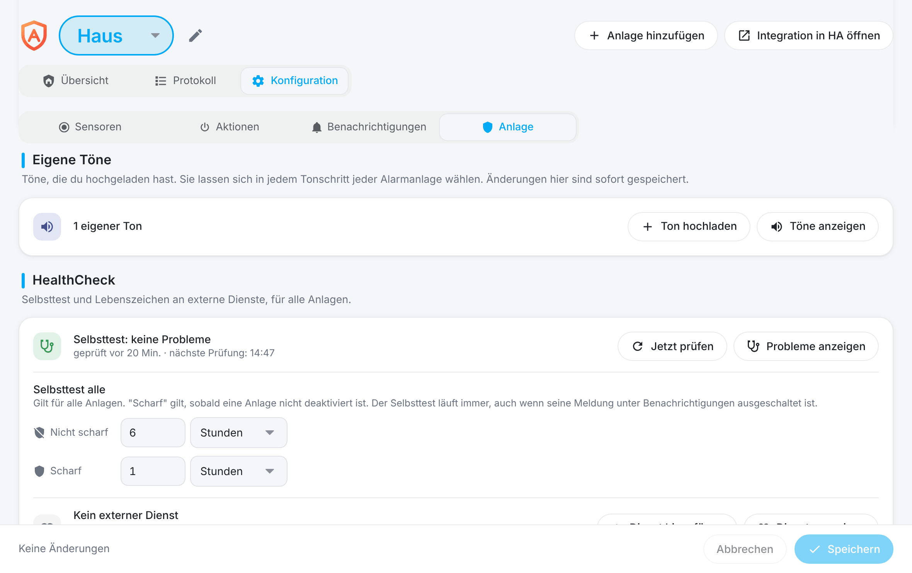</p>

- **Töne stellen den Lautsprecher zurück.** Aktivierungston, Deaktivierungston, Voralarm und der Alarmton in den Listen ausserhalb des Alarmablaufs merken sich, wie der Lautsprecher war (ein oder aus, Lautstärke, Wiedergabe), spielen in der gewählten Lautstärke und stellen ihn danach zurück. Standardmässig an, je Schritt abschaltbar.
- **Beim Deaktivieren:** ganz unten auf der Seite "Aktionen" hat das Kapitel "Beim Deaktivieren" unter dem festen Punkt "Anlage deaktiviert" eine eigene Liste, je Modus (der Modus, der scharf war). Was dort steht, läuft immer, wenn die Alarmanlage deaktiviert wird, auch mitten in einer Verzögerung oder im Alarm (nach den Aktionen nach dem Quittieren): zum Beispiel ein Deaktivierungston, ein Gerät, Warten, eine Szene oder eine eigene Aktion. Wieder scharf schalten oder ein Alarm beendet sie sofort.
- **Nach dem Quittieren:** hinter "Alarm endet (quittiert)" stehen eigene Aktionen, die laufen, sobald der Alarm quittiert oder die Anlage deaktiviert ist, zum Beispiel Storen schliessen oder Licht aus. Möglich sind Gerät, Ton mit Dauer, Warten, Szene und eigene Aktion. Ein neuer Alarm bricht sie ab.
- **Zurück in den vorherigen Zustand:** ein oder aus, Helligkeit, Position, Lautstärke und Quelle; Medienplayer, die ihre ganze Wiedergabe sichern können (Quelle, Titel, Gruppe), nutzen das.
- **Test:** führt den gespeicherten Ablauf ohne Alarm aus und endet spätestens nach 60 Sekunden. Ein echter Alarm während eines Tests startet den echten Ablauf sofort.
- **Medienplayer** holen die Töne bei Home Assistant und müssen darum dessen lokale Adresse erreichen (Einstellungen → System → Netzwerk).
- **Knöpfe der Alarmmeldung:** "Öffnen" (standardmässig an), "Alarmton stumm" (stoppt die Schritte, der Alarm bleibt), "Quittieren" (standardmässig an; beendet den Alarm, die Anlage bleibt scharf und alarmiert beim nächsten Auslöser wieder) und "Deaktivieren" (iOS fragt nach Face ID oder dem Gerätecode, Android nicht).
- **Kritische Meldungen:** die Lautstärke gilt für iOS; Android spielt sie auf dem Alarmkanal, dessen Lautstärke stellst du am Handy ein.
- **Wartungsmeldungen:** jedes Problem einmal, mehrere in einer Meldung, erneut nach dem Batteriewechsel oder wenn der Sensor wieder antwortet. Eine Batterie gilt erst als schwach, wenn sie bei mehreren Prüfungen hintereinander unter der Schwelle liegt (Standard 3, die Wartung prüft alle 15 Minuten, 1 bis 10); ein Wert über der Schwelle beginnt neu, ein Batteriesensor ohne Wert zählt nicht mit und beginnt nicht neu. Ein einzelner falscher Wert eines Geräts meldet nichts (seit 1.68.0). Beim Selbsttest ebenso: erneut erst, wenn ein Problem nach dem Beheben wiederkommt. Ein HealthCheck-Dienst: "antwortet nicht" einmal je Ausfall (auch über einen Neustart von Home Assistant), danach einmal "antwortet wieder".
- **Batterieprognose:** aus der Langzeitstatistik von Home Assistant über ein Jahr seit dem letzten Batteriewechsel (sonst aus dem Verlauf), gleich wie der Reiter Batterie der Sensoransicht bei "1 Jahr"; leer, wenn die Batterie nicht gefallen ist oder die Daten nicht reichen (mindestens 3 Tage).

### Routinen, Backup und HomeKit im Detail

- **Routinen:** unter Konfiguration › Anlage. Der Auslöser ist ein **Zeitplan** (eine oder mehrere Zeiten mit Wochentagen) oder ein **Gerät** (ein Schloss, Schalter, Türsensor, eine Person, jede Taste eines Fernbedieners oder Dimmers mit jeder Art des Drückens ...; Bedingungen "Gerät ist Zustand", "Tastendruck" und "Uhrzeit", verbunden mit "und"/"oder", mit einer Ebene Gruppen, wahlweise "muss N Sekunden gelten"). Eine Routine läuft, wenn ihre Bedingungen neu zutreffen: nicht solange sie zutreffen, nicht nach einem Neustart von Home Assistant und nicht bei der Rückkehr aus "nicht verfügbar" (ein Funkabriss schaltet die Anlage nie). Je Routine wählen fünf Schalter die Zustände der Anlage, in denen sie laufen darf (Ausgangsverzögerung, scharf, Eingangsverzögerung, beim Alarm, deaktiviert; standardmässig nur der letzte); im Moment des Auslösens zählt der Zustand, sonst wird die Routine übersprungen und das steht im Protokoll. Scharfschalten gilt nie bei Eingangsverzögerung oder Alarm. Offene Sensoren verhindern das Scharfschalten wie sonst; ein Code ist nicht nötig. Eine Routine löst keine andere aus, und eine Routine läuft nie zweimal innerhalb von 10 Sekunden.
- **Routinen im Panel:** die Seite zeigt eine Zusammenfassung und die Knöpfe "Routine hinzufügen" und "Routinen anzeigen"; die Liste öffnet in einem eigenen Fenster (auf dem Handy als Vollbild), Änderungen werden mit "Speichern" der Seite gespeichert. Bis dahin tragen neue und geänderte Routinen die orange Marke "Noch nicht gespeichert". Jede Routine ist eine Zeile mit dem Auslöser in Klartext, dem Ziel und Marken ("Umgeht den Code", die Zustände, in denen sie gilt). Das Suchfeld über der Liste findet alles, was die Zeilen zeigen, und die Entitäts-IDs der Geräte; Titel und Suchfeld bleiben beim Scrollen oben stehen (auch in den Fenstern "Eigene Töne", "Backups" und "Codes pro Person"). Der Stift öffnet den Editor, der mit einer Vorschau des Ablaufs endet (Auslöser, Prüfung des Zustands, Aktion oder "Übersprungen"). Das Auge davor zeigt dieselbe Vorschau nur zum Lesen, im selben Fenster: "Schliessen" führt zurück zur Liste, "Bearbeiten" öffnet den Editor.

<p align="center">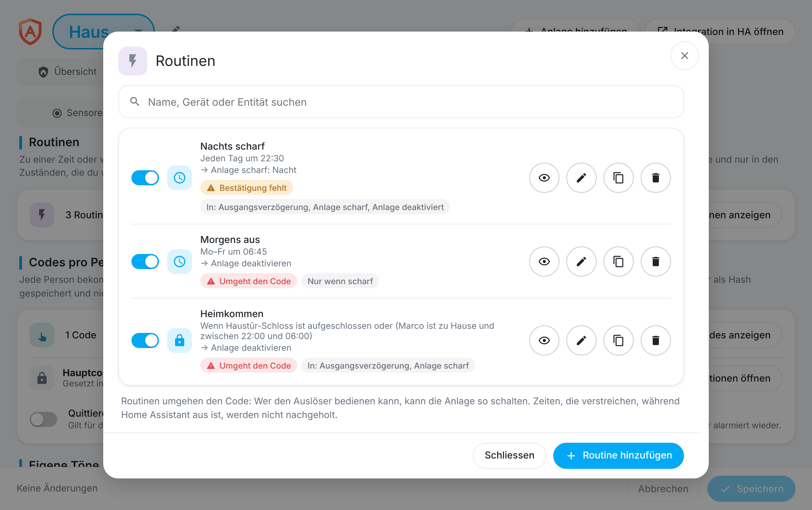</p>

- **Nur "Anlage deaktiviert" braucht keine Bestätigung.** Eine Routine läuft nur in den Zuständen, die du wählst. Eine neue Routine startet nur mit "Anlage deaktiviert"; jeder andere Zustand (Schärfe läuft, scharf, Eingangsverzögerung, Alarm) braucht zuerst die Bestätigung "Ich habe das verstanden" unter "Sicherheit", beim Deaktivieren wie beim Scharfschalten: Wer den Auslöser bedienen kann, würde sonst ohne Code deaktivieren oder den Modus wechseln (zum Beispiel von Anwesend auf Abwesend). Bis du bestätigst, lassen sich die anderen Zustände nicht einschalten, und schaltest du die Bestätigung aus, fallen sie wieder weg. Deaktivieren in anderen Zuständen trägt die Marke "Umgeht den Code". Routinen, die vor dieser Regel gespeichert wurden, laufen weiter und zeigen die Marke "Bestätigung fehlt", bis du sie erneut speicherst. Zeitpläne früherer Versionen sind beim Update zu Routinen geworden (Zustände: Ausgangsverzögerung, scharf, deaktiviert); alte Sicherungen werden beim Wiederherstellen umgewandelt.
- **Backup:** bis zu 10 eigene Backups in der Integration, dazu die letzten automatischen (standardmässig 5, 1 bis 50 wählbar; Schalter, Anzahl und Abstand unter Konfiguration › Anlage › Backup, gespeichert mit "Speichern" der Seite; geprüft jede Nacht um 03:17 und nach einem Start; eine gleiche Kopie wird nicht abgelegt), dazu Export und Import als Datei. Die Seite zeigt oben "Letztes Backup" mit den Knöpfen "Backup erstellen" und "Backups anzeigen" (wie bei Routinen, eigenen Tönen und Codes), darunter das automatische Backup. Die Liste der Backups öffnet in einem eigenen Fenster, dort auch Export und Import, ein Suchfeld und der Filter "Nur automatische". Beim Wiederherstellen wählst du für jede Anlage des Backups, worauf sie angewendet wird: eine bestehende Anlage (gleich wie sie heisst), eine neue oder keine; die gemeinsamen Einstellungen lassen sich weglassen. Die HealthCheck-Dienste sind mit ihrer URL enthalten. Codes sind nie enthalten; das Backup von Home Assistant selbst enthält alles. "Was ist im Backup?" über der Karte klappt die ganze Liste auf: je Anlage Name, Modi, Sensoren und Zonen, Optionen je Sensor, Verzögerungen und Verhalten, alle Aktionen, Routinen, Regeln der Überwachung und die Meldungen je Ereignis; für alle Anlagen Voreinstellungen je Sensorart, Benachrichtigungen (mit den Abständen des Selbsttests), Anzeige der Namen, eigene Töne und die HealthCheck-Dienste. Nicht enthalten: Codes und Hauptcode, das Protokoll (Alarme, Ereignisse, Aufzeichnungen der Alarme), Verlauf und Statistik der Sensoren, der Zustand der Anlagen, Ergebnisse von Selbsttest und Lebenszeichen (samt dem Protokoll der HealthCheck-Dienste), die Einstellung des automatischen Backups und die Ansicht in deinem Browser.
- **Akzentfarbe je Alarmanlage:** Unter Konfiguration › Anlage, über dem Einrichtungsassistenten, öffnet eine Zeile mit dem Knopf "Akzentfarbe ändern" ein Fenster, in dem du die Farbe wählst der Knöpfe, Schalter, Pfeile und Markierungen dieser Alarmanlage, aus denselben zehn Farben wie im Device Panel (Home Assistant, Himmelblau, Ozeanblau, Türkis, Indigo, Rosa, Orange, Rot, Tannengrün, Graphit; "Home Assistant" folgt der Farbe deines Themes). Die Zeile zeigt die gewählte Farbe als Punkt mit ihrem Namen. Das Fenster zeigt unter den Farben eine Vorschau zum Ausprobieren (Reiter, Schalter, Haken, Marke, Knopf und Schieber reagieren in der gewählten Farbe, es wird nichts geändert), "Übernehmen" nimmt die Wahl in die Seite; gesichert wird sie mit "Speichern" der Seite (bis dahin trägt die Zeile "Noch nicht gespeichert"); sie gilt für alle, die das Panel öffnen, und jede Alarmanlage hat ihre eigene. Beim Hinzufügen einer Alarmanlage wählst du die Farbe im selben Fenster. Die Farbe gehört zum Backup.
- **Codes pro Person im Panel:** unter Konfiguration › Anlage zeigt die Seite die Zahl der Codes mit den Knöpfen "Code hinzufügen" und "Codes anzeigen" (wie bei Routinen und eigenen Tönen), dazu den Hauptcode und "Quittieren verlangt den Code". Das Fenster (auf dem Handy als Vollbild) zeigt eine Tabelle mit Name und Benutzer, sortierbar, mit Suchfeld, und je Zeile runde Knöpfe zum Bearbeiten und Entfernen. Ein Code wird nie angezeigt: gespeichert ist nur ein Hash, kein Code lässt sich wieder anzeigen. Der Stift öffnet dasselbe Fenster wie "Code hinzufügen" (in der Fusszeile) mit Name und Benutzer; leere Codefelder behalten den bisherigen Code. Das Auge im Codefeld blendet den gerade getippten Code ein und wieder aus. Einfache Codes zeigen eine rote Warnung (Zahlenfolgen wie 1234 oder 2468, nur eine Ziffer, wiederholte Muster wie 1212 oder 1122, drei gleiche Ziffern hintereinander, Spiegelzahlen, Linien auf dem Tastenfeld wie 2580, Jahreszahlen, Daten wie 24121990); speichern lassen sie sich trotzdem. Codes mit weniger als 4 oder mehr als 8 Ziffern nimmt die Integration nicht an.
- **HomeKit, Ausgangsverzögerung:** Apple Home zeigt während der Ausgangsverzögerung "Aus" mit dem Ziel "Abwesend". Für "Anwesend" und "Nacht" keine Ausgangsverzögerung verwenden (Standard).
- **HomeKit, Eingangsverzögerung:** Apple Home zeigt weiter "scharf" und wechselt auf "Alarm", wenn der Alarm beginnt.

### Für Entwickler

```bash
pip install -r requirements_test.txt
python -m pytest                      # Tests gegen ein echtes Home Assistant
python scripts/mutation_check.py      # baut jede Schutzmassnahme aus, ein Test muss scheitern
cd tests/panel && npm ci && node run.mjs   # Tests der Oberfläche (Playwright)
```

- Die Bilder der README und dieses Handbuchs stammen aus dem Nachbau: `node tests/panel/readme-shots.mjs`, danach `python scripts/optimize_images.py`; die Schaubilder aus `python scripts/make_diagrams.py`.
- Konzept und Entscheide: [docs/CONCEPT.md](https://github.com/Diegofuego871/ha-alarmageddon/blob/main/docs/CONCEPT.md). Änderungen: [CHANGELOG.de.md](https://github.com/Diegofuego871/ha-alarmageddon/blob/main/CHANGELOG.de.md).
