# Alarmageddon: Manual

[Deutsch](https://github.com/Diegofuego871/ha-alarmageddon/blob/main/docs/MANUAL.de.md) · [Back to the overview](https://github.com/Diegofuego871/ha-alarmageddon/blob/main/README.md)

All the details about Alarmageddon. The quick start (idea, installation, tour) is in the [README](https://github.com/Diegofuego871/ha-alarmageddon/blob/main/README.md).

## Contents

- [The interface](#the-interface): overview, sensor view, sensors and zones, alarm actions, notifications, self-test, HealthCheck, monitoring, alarm, log, dashboard cards
- [Safety mechanisms](#safety-mechanisms) and their limits
- [Apple HomeKit](#apple-homekit)
- [Entities](#entities)
- [Good to know](#good-to-know): how an alarm runs, numbers and limits, options per sensor, actions, routines, backup, for developers

## The interface

### Overview

All alarm systems at a glance: arm and disarm, "Ready for" per mode with the sensors that still block arming, a status tile for warnings, and all sensors as a list or as cards (all the same height), with search, filters, sorting, a choice of columns and grouping by area, sensor type or alarm system. A tap on a sensor opens its view: what it did over the last hours or up to 30 days (with a chart for each kind of sensor and the list of events), how its battery and its signal are doing, and a button that opens it in Home Assistant. In the view you also choose how the sensors are called: "Device - Sensor" or only the name of the sensor, the same everywhere down to the push notification. The same on the phone:

<p align="center">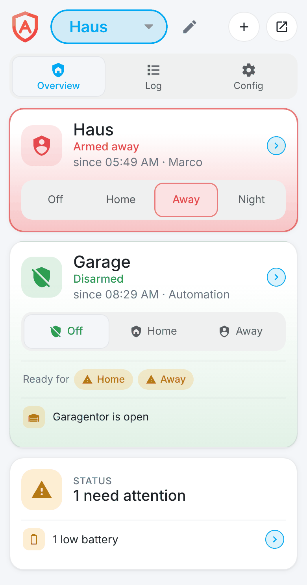</p>

### Sensor view

A tap on a sensor shows what it did: a chart of its own for each kind of sensor over 3 hours up to 30 days (doors and windows as a timeline, motion as a grid of day and hour), below it the events with their duration and the state of the alarm system at that moment. The tile "History" says since when the current state holds: since the last real change between open and closed (for motion the end of the last motion), never the time of a restart of Home Assistant; if the sensor is unreachable, since the start of the outage; without a known change only the state. The list always holds the events of the chosen period, and so does the number on its tab "Events" (sensors of the monitoring); with more than 300 the list shows the newest 300 and says so below. The tiles "Battery" and "Signal" show their history, the battery with the warning threshold, battery replacements and a forecast. "Signal" also works for Bluetooth and ZHA devices that have no signal sensor: Alarmageddon reads the value from Home Assistant itself (with several Bluetooth adapters or proxies the strongest one counts, without jumping back and forth) and records the history on its own. You only see the value and the chart. Thread devices (Matter) work the same way, using the neighbour table of the device.

<p align="center">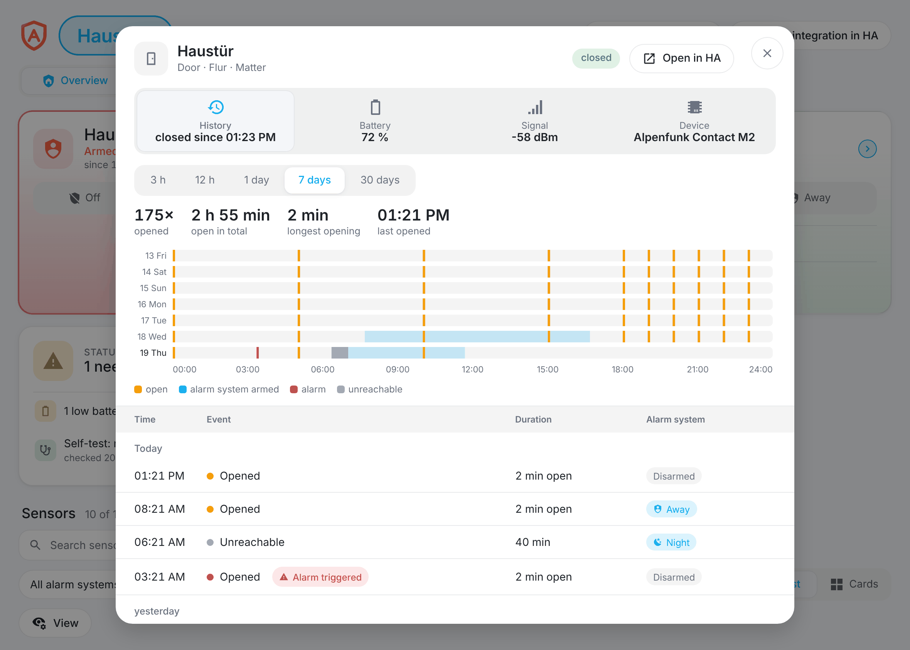</p>

### Sensors and zones

One table for sensors and zones: tick where a sensor belongs, or drag across several boxes. Every sensor type has sensible defaults (a smoke detector is always active, a motion sensor may still report motion when arming), each sensor can have its own values, and the switch "Settings per mode" adds a tab per mode for those who want more. The round pencil at the end of a row opens the settings of the sensor; on the computer the round bin next to it removes the sensor.

<p align="center">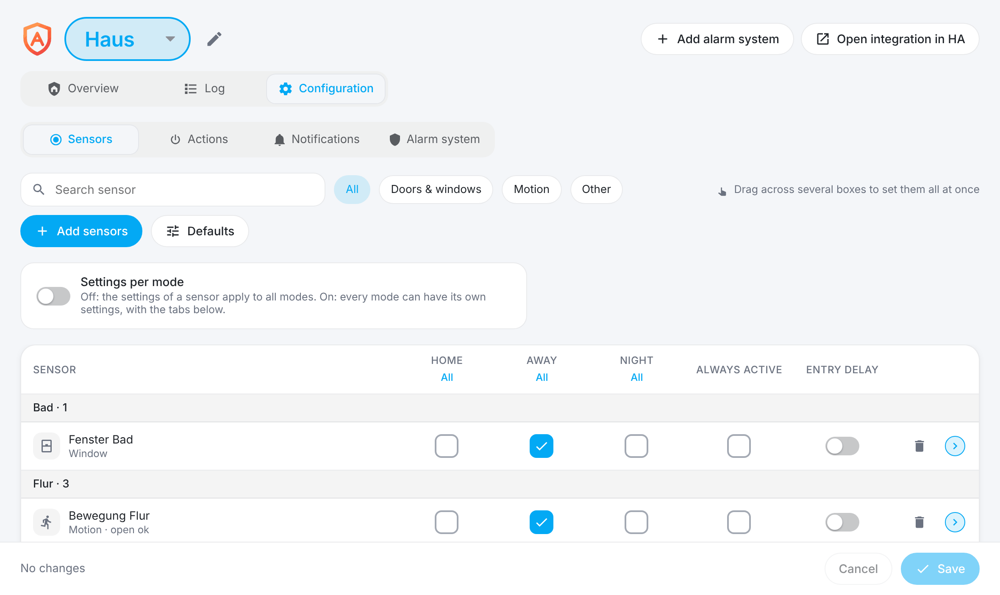</p>

### Alarm actions

What happens on an alarm is a flow you build from steps, per mode if you like. Devices marked with the arrow return to their previous state when you disarm, and every step can be tested on the real devices with its play button.

<p align="center">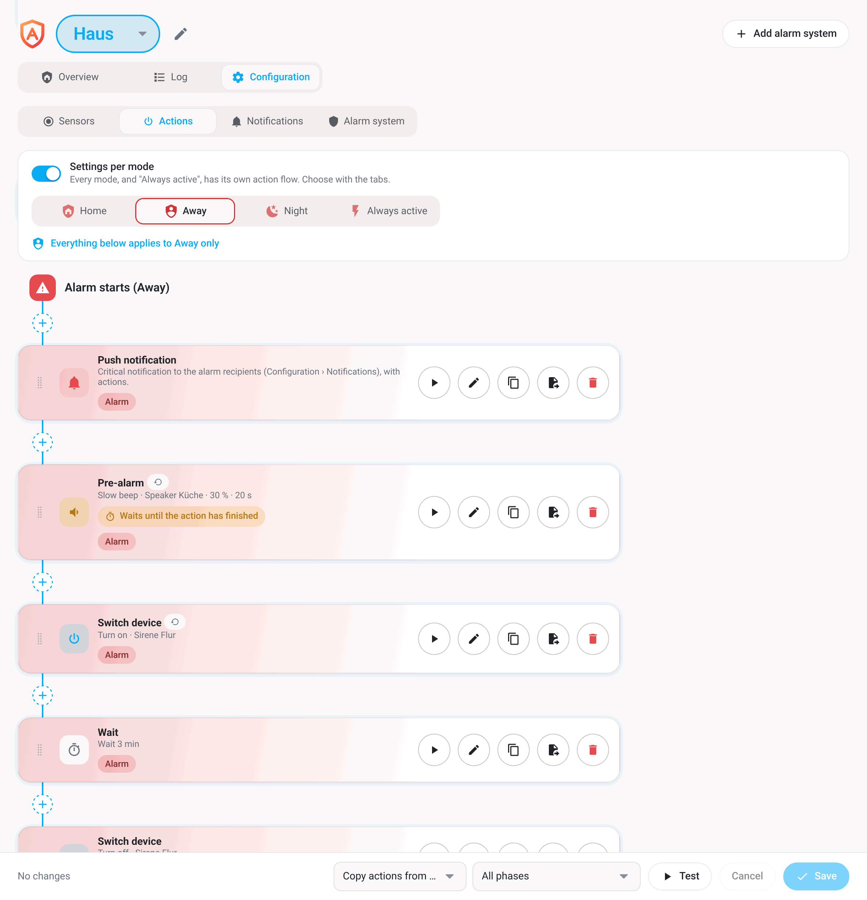</p>

<p align="center">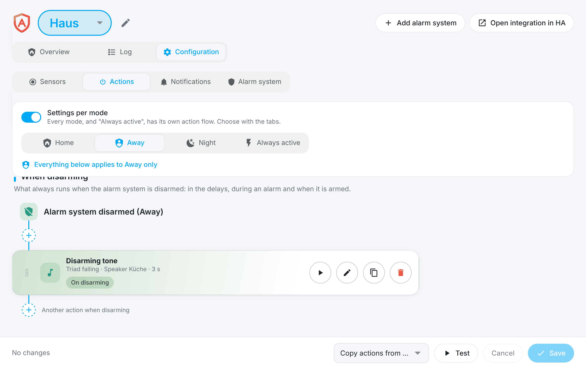</p>

| Step | Does |
| --- | --- |
| Push notification | Critical alarm notification to the alarm recipients, with your own title and text (placeholders for alarm system, sensor, sensor type, area, time, mode and kind of alarm; smoke, water, gas and heat sensors bring a fitting default text), optional buttons and, if you like, its own recipients (every title starts with an emoji) |
| Switch device | Lights, sockets, sirens, covers, locks and more: on, off, open, close, with brightness or position; optionally undone after a set time (a socket with a siren: on, off after 2 minutes) |
| Play alarm sound | One of five sounds on media players, with volume, for a duration or until disarmed |
| Wait | Pauses the following steps, for example between "siren on" and "siren off" |
| End alarm (acknowledge) | Ends the alarm after the steps before it (for example after 3 minutes), returns the devices and keeps the alarm system armed; the steps after it do not run |
| Scene, script or own action | Anything else Home Assistant can do |
| Action group | Repeats several actions in their order (for example a flashing light): a number of rounds, for a duration or until disarmed |

On the same page the messages of the flow sit as fixed elements at their point: "Armed", "Silent alarm", "Entry delay", "Disarmed" and the closing message under "Alarm ends". All five are built the same way: switch (send or not), play (test message) and pencil (own text, recipients, critical). Before the alarm there is the chapter "On a silent alarm" with its own actions for sensors with the option "Silent alarm".

<p align="center">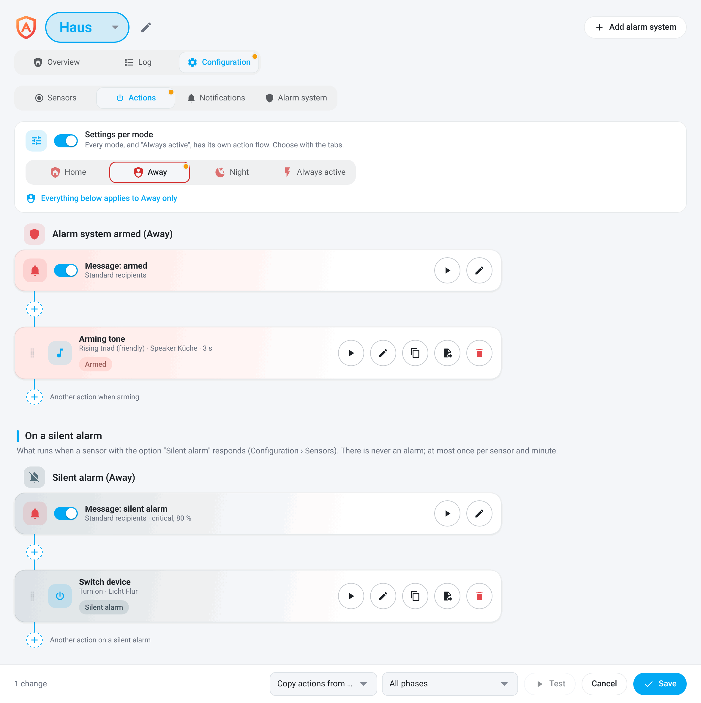</p>

### Notifications

The standard recipients are chosen separately for alarms and for maintenance messages, and every message can override them with its own recipients. Below follow the chapters "Fault messages" (arming not possible, sensor unreachable while armed) and "Maintenance messages" (sensor unreachable, low battery with "Low below" and "Message after … checks", self-test; its interval is under Configuration › Alarm system › HealthCheck). The chapter "HealthCheck services" (since 1.68.0, always shown, also without a service) holds "Message after … failed calls" (1 to 10 in a row, default 2; every automatic call counts (interval, after saving, change of the self-test), never the test button) and the two messages "Service is not answering" (once per outage) and "Service answers again" (at the first call that works again, only if "not answering" went out). They are built like the fixed messages in the Actions tab: switch, play (test message with the values of the card, also unsaved) and pencil with title and text (placeholders {name}, {host}, {reason}, {count}, {since}; never the URL), recipients (default: the maintenance recipients), critical with volume, "stays in Home Assistant" and the target of a tap (default: the list of the HealthCheck services). A failed life sign no longer goes out via the message "Self-test"; it stays a problem of the self-test. Every kind can be switched on or off, be critical (sounds in silent mode) and have its own volume; the failure while armed per mode if you like. The messages "Armed", "Disarmed", "Entry delay" and "Silent alarm" are in the Actions tab, at their point in the flow of every alarm system. "Arming not possible" carries two buttons: "Try again" arms the same mode once more, "Arm anyway" arms although sensors are open and bypasses them until you disarm. They work for one hour, only while the system is disarmed and only from the phone of a recipient of that message; each can be switched off.

### Self-test

Alarmageddon checks itself regularly. Are all devices, speakers, actions (services), recipients and custom sounds that the actions, the monitoring rules, the routines and the notifications use still there and reachable? Do the sensors of the alarm systems still exist, and does Home Assistant have an address for the speakers? During operation it also records steps that failed or did not answer within 10 seconds, interventions of the watchdog, notifications that did not go out, parts of an alarm system that did not start, a failed automatic backup and life signs to the HealthCheck services that did not go out.

- **When:** a few minutes after Home Assistant starts (the devices connect first), shortly after every save, every 6 hours and every hour while an alarm system is armed, that is not disarmed (both from 5 minutes to 24 hours, each as number and unit, minutes or hours, under Configuration › Alarm system › HealthCheck, "Self-test every", "Not armed" and "Armed" one below the other, saved with "Save" of the page; after arming the next check follows within a minute once the armed interval has passed) and with "Check now" (in the window of the self-test and in the chapter HealthCheck).
- **In the panel:** the status tile of the overview always shows a row "Self-test" with the time of the last check; problems count towards "N need attention" (red when a problem can prevent or silence an alarm). Once HealthCheck services are set up (since 1.68.0), this row is split in the middle without making the tile taller: on the left "Self-test", on the right "HealthCheck" (green when all services are OK, orange while a failure is reported, red as soon as one failed; a tap opens the list of services). Without services the row stays as before. A click opens a window with every problem, grouped by alarm system and "All alarm systems": what is wrong, where (with "Open", which jumps to the step, rule, routine or setting), what it means, possible causes and how to fix it.
- **Checked:** the round arrow in the card "No problems found" (with problems: in the card "N entries checked" below them) opens the list of everything the last check looked at, grouped: sensors of the alarm systems, sensors of the monitoring, devices in the actions, speakers, devices that trigger routines, actions (services) and recipients. Every entry shows its name and entity ID (with several alarm systems also where it is used) and a green check mark when it is in order, otherwise a warning sign; a search field finds entries. The list belongs to the last check and survives a restart.
- **What counts:** a device that a step switches (siren, switch, speaker) counts as soon as it has been unreachable for 5 minutes, not only when it is missing. Sensors of the alarm systems and of the monitoring count only when they are missing; unreachable sensors are reported by the maintenance messages (no double message). Flows of a mode that is switched off are not checked.
- **Clearing:** a setup problem disappears by itself once it is fixed (at the next check; after saving the self-test checks again shortly afterwards). A problem during operation disappears as soon as the same call works again, in an alarm or a test, or with "Done" in the window.
- **Elsewhere:** each alarm system has an entity "Self-test" (problem; its own problems and those for all alarm systems), the status entity and the dashboard card count the problems, and Home Assistant shows them under Settings › Repairs (one message per alarm system, one for all of them). The maintenance message "Self-test" reports every new problem once.
- **Read only:** the self-test never switches a device, plays no sound and sends no test message. It never holds up an alarm: a fault in the self-test stays in the self-test.

### HealthCheck

If Home Assistant itself fails (power, crash, no internet), nothing inside it can report that. A HealthCheck service outside can: Alarmageddon sends it a life sign at a fixed interval, and when the life signs stop, the service alerts you by e-mail, push or SMS, depending on the service. The chapter "HealthCheck" under Configuration › Alarm system applies to all alarm systems and holds the self-test (last check, "Check now", "Show problems", "Self-test every") and the life signs.

<p align="center">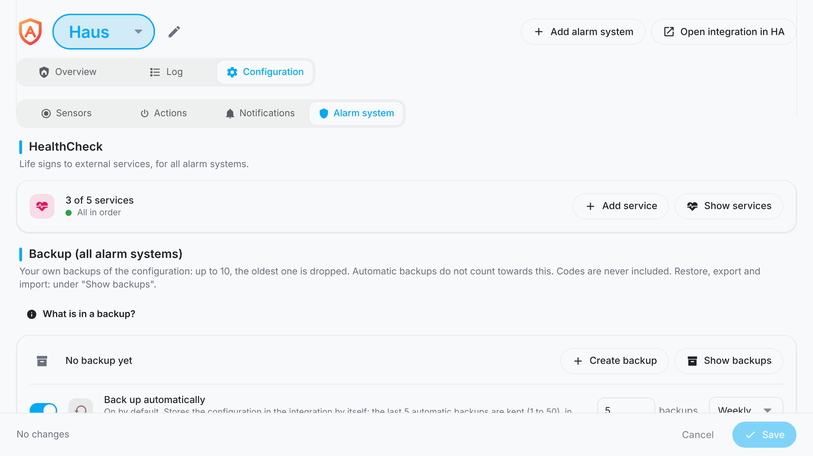</p>

- **Services:** up to 5, for example Healthchecks.io, Cronitor, Better Stack or Uptime Kuma; any service that accepts a simple call of a URL (GET) works. The row in the chapter shows how many are set up and whether a life sign failed, with "Add service" and "Show services". Below the list, "What are HealthCheck services?" unfolds: what these services do (they wait for life signs from outside and alert you when Home Assistant, the power or the internet fails), how the failure suffix works and how to set up a check, with Healthchecks.io, Cronitor, Better Stack and Uptime Kuma as examples (links; Uptime Kuma runs on your own computer, so only on another one in another place than Home Assistant makes sense).
- **Generic:** each entry has a **name** (required, up to 60 characters; it appears in the list, in notifications and in the self-test). The **ping URL** (http or https) that the service shows for its check. The **failure suffix** (optional): as long as the self-test has problems, Alarmageddon calls the URL with this suffix instead, so the service reports a failure at once instead of only after the missing life sign; "/…" extends the path (`/fail`), "?…" or "&…" sets parameters (`?state=fail`, a parameter of the same name is replaced). Empty: only the life sign goes out. The **interval** from 1 minute to 24 hours, as number and unit or with a quick choice (1 min, 5 min, 15 min, 1 h, 6 h, 24 h). There is no separate interval while armed: the self-test checks more often then, and when it finds a problem, the failure call goes out at once. Alarmageddon looks every 10 seconds which life sign is due. At the service, set the period (and grace time) a little longer than the interval.
- **Suggestions:** for well-known services the form recognizes the URL and suggests the suffix: Healthchecks.io (also self-hosted with `/ping/<uuid>`) and Better Stack `/fail`, Cronitor `?state=fail`, Uptime Kuma `?status=down` (from its push URL; not tried against a real Uptime Kuma). The suggestion is only filled in while you have not touched the field; otherwise it stands next to it with "Use". You always have the last word. Below the field a preview shows the exact failure call.
- **When:** right after saving, at the interval, and at once when the result of the self-test changes (problems found or all fixed), at most once a minute per service. After a start of Home Assistant the first life sign goes out after 30 seconds.
- **List:** the window shows a table with search and sorting (service, last, interval, status). Every row shows the name, the URL shortened to one line (in full in the tooltip and in the form), the recognized service, the suffix, the time of the last life sign, the interval and the result ("Life sign sent", "Failure sent", "Failed" with HTTP status, "no answer" or "no connection"). Per row round buttons, like for routines and sounds: "Log" (since 1.68.0, see below), "Send failure" (only with a suffix) and "Send life sign" as a test, edit and remove; on the phone they have a row of their own below the entry. "Close" and "Add service" stand next to each other at the bottom right. After a test with "Send failure" the service stays down until the next life sign; "Send life sign" restores it at once.

<p align="center">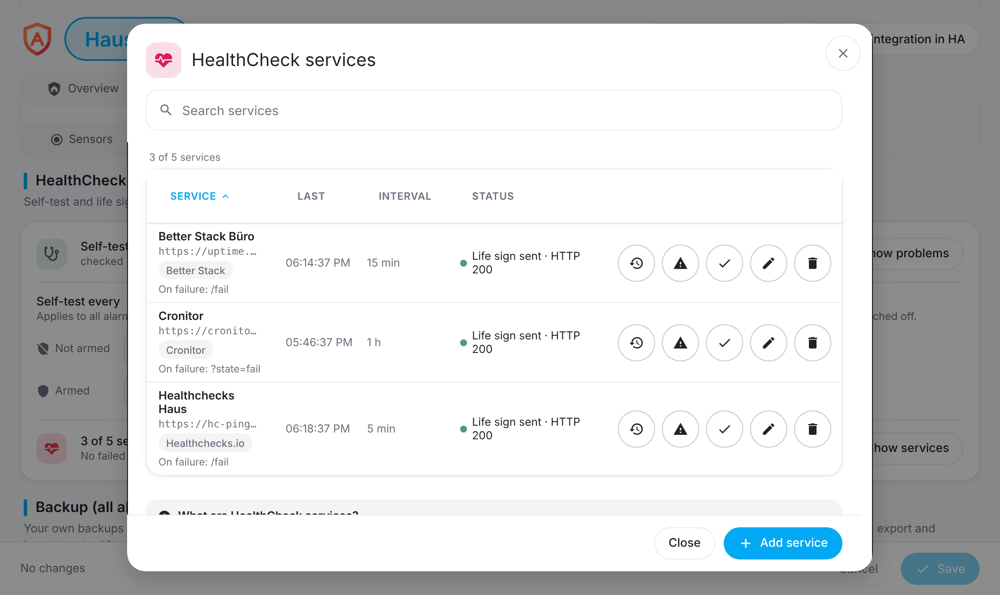</p>

- **Log (since 1.68.0):** the round button "Log" opens the log of a service, built like the sensor view. At the top the tinted heart, the name as a dropdown to switch to another service (each with a dot in the colour of its state and "OK since …" or "Failed since …"), below it the host, the recognized service and the interval, on the right the state and "Edit" (opens the form). Three tiles: **History** (state since when), **Response time** (of the last call) and **Service**. The period runs from 3 hours to 1 year (3 hours, 12 hours, 1 day, 7 days, 30 days, 90 days, 1 year; on the phone in one row, on very narrow phones in two). History up to 1 day is a "heartbeat": one bar per call or section, its height the response time, its colour the result (life sign green, failure reported orange, failed red, test blue, no data grey because Home Assistant was off), with a band below that shows the state without a break and marks every failure and test. 7 days show a time line per day (green as long as life signs arrive, marks for failures and tests), 30 days a grid of days and hours like motion sensors (the worst result of each hour), 90 days and 1 year a grid of months and days (one row per month, one cell per day: green all arrived, orange failure reported, red failed, grey a gap of more than 30 minutes without data, a test as a blue dot), with the number of days with a failure, a failure report or a gap below. Figures: successful (in percent), life signs, failed, failures reported, mean response time. **Response time** shows a line with the zones fast (up to 300 ms), slow and very slow (over 1 s) and a dashed red mark for every failed call, with the figures now, on average, slowest call and without answer; over 90 days and 1 year the mean per day and a mark on every day with a failed call. **Service** lists name, recognized service, ping URL, failure suffix, call on failure, interval, state, last call and since when the log records, each with a copy button. Below, two tabs: **Events** (default: failed, failure reported because of the self-test with the number of problems, test, OK again, first life sign after a start; consecutive failures are one event with their number) and **All calls** (every call with result, response time and trigger: interval, self-test, test, start, saved). Both follow exactly the period chosen above, and the number on the tab is the number of the list. Single calls are kept for 24 hours; from 7 days on the list "All calls" shows the last 24 hours and says so, older calls are summarized in the chart and the figures. From 90 days on, chart, figures and list cover whole days. Search and sorting by every column, the table head stays in place. Kept: single calls 24 hours, hourly values 30 days, daily values and events one year (at most 1000 events per service); usually about 60 KB per service at a 5-minute interval, at most about 160 KB. The log is written at most 10 minutes after a call and when Home Assistant stops, so a crash costs at most the last minutes. The log is runtime data: it is not part of backups, it never contains the URL, and it is removed with the service. It starts with the update to 1.68.0.

<p align="center">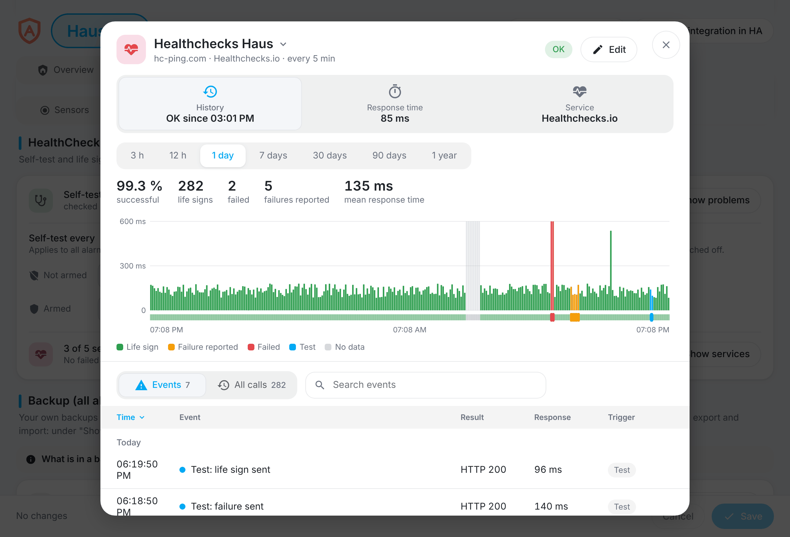</p>

- **When a life sign does not go out:** it becomes a problem of the self-test ("Health check "…" failed" with the name, the host and the reason; "Open" leads to the list) and disappears with the next life sign that works, or when you remove the service. It does not count as a failure for the next life sign (it could not be reported the same way).
- **Security:** the ping URL is shown in full in the panel and stored in backups, because it is your setting. The log, notifications and problems of the self-test only name the host (for example `hc-ping.com`). A life sign waits at most 10 seconds and never holds up an alarm, a save or the self-test.

### Monitoring

Besides the alarm, Alarmageddon can watch things that have nothing to do with intruders: a fridge that gets too warm, a damp cellar, bad air, a fridge door left open. Switch it on under Configuration › Alarm system › Modes (off by default); then measured values (temperature, humidity, CO2 ...) can be added in the sensor list (greyed out there: no zone, never always active, no entry delay) and the tab "Monitoring" appears next to the modes under Configuration › Actions.

Every rule is a chapter with its flow: "Outside the limits" (orange) and "Back to normal" (green), built from the same kind of steps as the alarm actions, but only push notification, switch device and wait. A rule has a condition (measured value above, below or outside limits, device state, time window, "alarm system is armed", combined with And/Or), a duration the condition must hold (for example 30 minutes), a return margin against flapping around the limit and, if you like, a reminder every few hours. Texts know the placeholders `{rule}`, `{sensor}`, `{value}`, `{unit}`, `{limit}`, `{since}` and `{name}`; without an own text a fitting default is sent, to the recipients you choose or the recipients of the maintenance messages.

<p align="center">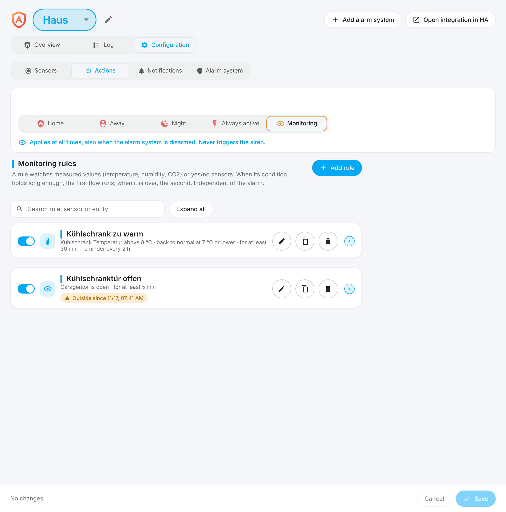</p>

Every step of a rule has a play button that runs just this step once (a push message with the title "Test: ...", or the device is switched), also before the rule is saved; "Wait" has nothing to test.

Monitoring runs always, also while the alarm system is disarmed, and never triggers the siren or the alarm (fire and water stay with "Always active"). A sensor that does not respond never counts: it neither triggers a rule nor ends it, so a radio loss never reports "back to normal". A running rule does not report again after a restart.

The measured sensors of the monitoring (temperature, humidity, CO2) also appear in the panel overview with their value, and a tap opens the same view as for every sensor: the tab "History" with the course of the values, battery, signal and device. Below the chart there are only the events of the monitoring ("Outside the limits", "Back to normal"), never the single values. Every limit of a monitoring rule with this sensor is drawn as a dashed line; the chart reaches up to it even if it lies far from the values (the curve then becomes flatter). For every sensor that appears in the monitoring (measured values and yes/no sensors in a monitoring rule) there are two tabs above the list: "Events" and "Rules". "Rules" lists the monitoring rules with this sensor, of every alarm system, with the condition in words and their state ("Active", "Off", "Outside" when it is triggered right now). Both lists have a search field and can be sorted by every column (tap the column title; sorted by time, the list keeps a row per day). The arrow of a rule leads to it under Configuration › Actions › Monitoring, unfolded and briefly marked; if you have unsaved changes in another alarm system, the panel asks first. The editor of a rule explains the return margin with your own values: at which value the rule triggers, from which value it is back to normal and where the buffer zone lies.

### When there is an alarm

An alarm cannot be overlooked: a red band with the sensor that triggered and the buttons "Acknowledge" (the alarm ends, the system stays armed) and "Disarm". The tile of the alarm system says since when the alarm has been running, what triggered it and who armed the system when. The same buttons are in the push notification on the lock screen.

<p align="center">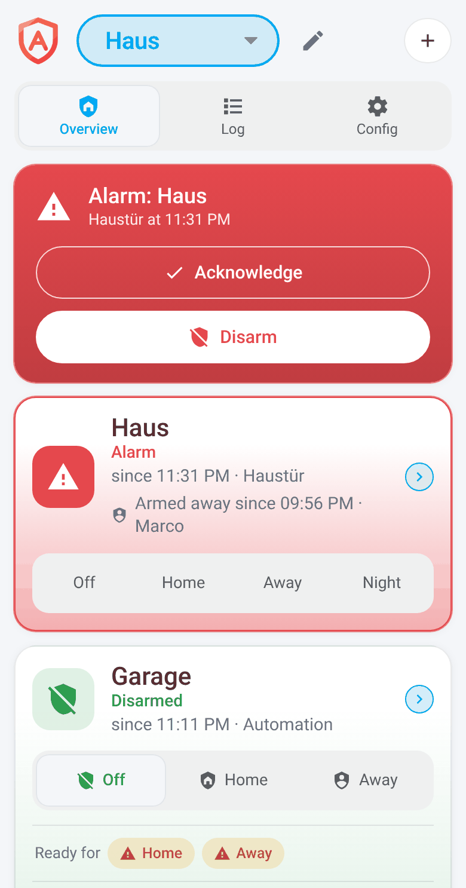</p>

### Log and alarm timeline

Every alarm is recorded from the first trigger until someone acknowledges it: which sensor responded when, which steps ran, which notifications went out. All other events (armed, disarmed, routines, sensor failures) are on the second tab, with a filter by period and a CSV export. Both are kept for a year; you can delete a single alarm.

An alarm as it happens, with invented data (phone on the left, computer on the right):

<p align="center"> </p>

<p align="center">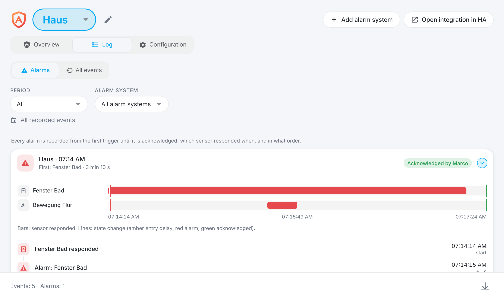</p>

### Dashboard cards

The control tile and the status tile of the side panel are also available as cards for any dashboard: "Add card" › "Alarmageddon". Anyone who may see the dashboard can use the card, not only administrators. A code is asked for wherever one is programmed; whether "Acknowledge" needs it, the administrator decides in Configuration › Alarm system.

<p align="center">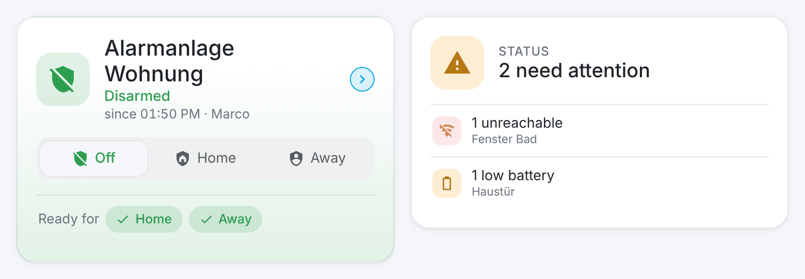</p>

If the card does not appear in the card picker: restart Home Assistant after the update, reload the page (Ctrl+Shift+R; in the app: Settings › Troubleshooting › reset the frontend cache), or add a card manually with `type: custom:alarmageddon-card` and `entity: alarm_control_panel.<name>`. The message "Custom element doesn't exist" means the card file was not loaded yet.

### More

- **Routines:** arm or disarm at set times on chosen weekdays, or when a device does something, for example when the smart lock locks. Several conditions can be combined with "and" and "or", in groups. Each routine only applies in the alarm states you choose.
- **Codes per person:** everyone gets their own code; the log shows who armed and disarmed.
- **Modes:** "Home", "Away" and "Night", each switchable on and off, each with its own zone, delays and actions.
- **Two-sensor confirmation:** a motion sensor can require a second sensor before it triggers, against false alarms.
- **Backup:** all settings as a file or stored in the integration, never with codes. An automatic backup (daily, weekly or monthly; on and weekly by default) keeps the last 5 (you choose 1 to 50), in addition to your own 10.
- **Several alarm systems:** house and garage, each as its own device. "Add alarm system" at the top of the panel shows the device and the alarm entity before anything is created; the button next to the entity ID copies it (for automations and dashboards).
- **Back to the overview:** the panel remembers where you were for 30 minutes; after that it starts on the overview again.

## Safety mechanisms

An alarm system has to work when something else does not. These mechanisms are built in and checked by tests on every change.

<p align="center"></p>

| Mechanism | What it guarantees |
| --- | --- |
| When in doubt, alarm | An entry delay that ran out while Home Assistant restarted becomes an alarm, with alarm actions, notification and recording. During an entry delay or an alarm, arming is refused: only disarming leads out |
| Safe on restart | State, delays and a running alarm continue after a restart; the alarm actions go on at the step they had reached, or start from the beginning when no run was stored. Every change of state is written at once, so the last state also holds after a crash or a power loss |
| Codes | 4 to 8 digits, stored only as a salted hash, never shown, never in a backup or a log. Five wrong codes lock the alarm system for one minute, also for the right code; simultaneous attempts are checked strictly one after the other |
| Administrators only | The side panel and every one of its commands need administrator rights. The dashboard cards use only entities and services, with the codes Home Assistant checks |
| Buttons in the alarm notification | "Disarm" and "Silence alarm sound" are off by default, "Acknowledge" is on. They only work while the alarm is running and only from the phone of a configured alarm recipient |
| Nothing holds up the siren | A device that does not answer is skipped after 10 seconds, a push notification is never waited for, and a failing step, log, recording or notification never stops the rest |
| Watchdog | The alarm actions are supervised as a whole: the first step starts within 8 seconds, no step delays the next one beyond its limit, and a flow that breaks off goes on with the next step. Interventions appear in the timeline of the alarm |
| You decide how long the siren sounds | There is no fixed duration in the code. You set it in the flow ("wait" between on and off, or a duration for a sound, up to an hour per step). It is kept exactly and counts from the first start, also across a restart |
| Self-test | Checks regularly whether everything the alarm systems use is there and reachable, and records what failed during operation; it only reads and never holds up an alarm |
| HealthCheck | Life signs to an external service: if Home Assistant fails or loses the internet, the service alerts you; problems of the self-test are reported there too. A life sign waits at most 10 seconds and never holds anything up |
| Sensors that fail | A sensor that becomes unreachable while armed is reported at once, or triggers the alarm with the option "failure counts as alarm". Low batteries are reported before they are empty |
| Tested | More than 1,500 automated tests against a real Home Assistant (in two versions, an older and a current one), about 7,400 checks of the interface on computer and phone, and a mutation check that removes each of 368 safeguards and requires a test to fail |

### Limits

Alarmageddon is not a certified alarm system. Please keep in mind:

- If Home Assistant, the power, the network or the radio coordinator fails, there is no alarm. A siren with its own battery helps for critical use; a HealthCheck service at least tells you that Home Assistant is silent.
- How long a siren may sound is regulated differently from place to place. Check what applies to you and set the duration in the alarm actions; a siren with its own time limit is the safest choice.
- A sound "until disarmed" and a siren without an "off" step run until someone disarms. That is your choice in the flow.

## Apple HomeKit

1. Add the alarm entity to the HomeKit Bridge of Home Assistant (include the domain `alarm_control_panel` or the entity).
2. Apple Home shows "Off" and the modes that are switched on.
3. With a code: HomeKit does not ask for it. Set it in the HomeKit Bridge configuration (`entity_config` → `code`) or as default code in the entity settings.

## Entities

| Entity | Content |
| --- | --- |
| `alarm_control_panel.<name>` | The alarm system. Attributes: `arm_mode`, `triggered_by`, `bypassed_sensors`, `deadline`, `changed_by`, `armed_at`, `armed_by`, `state_since` (since when it is in its state; survives a restart) |
| `binary_sensor.<name>_zone_<mode>` | On when a sensor of the zone of this mode is open |
| "Ready to arm" per mode | On when no open sensor blocks arming in this mode. Attribute: `blocking_sensors` |
| `sensor.<name>_status` | Number of open problems: alarm, unreachable sensors, weak batteries, problems of the self-test. Attributes: `alarm`, `offline`, `low_battery`, `battery_threshold`, `selftest`, `selftest_last` |
| `binary_sensor.<name>_self_test` | Self-test (problem, diagnostic): on while the self-test has found something that affects this alarm system, unknown before the first check. Attributes: `last_check`, `count`, `problems` (the first 20, only kind and ID) |

Zone and "Ready" entities exist only for the modes that are switched on.

Service `alarmageddon.acknowledge` (target: the alarm entity, optional `code`): silences a running alarm; usable by every user, used by the dashboard card.

## Good to know

Details for those who want to know exactly.

### How an alarm runs

<p align="center"></p>

- Only a real change from closed to open triggers. A sensor that comes back from "unavailable" as open does not.
- A sensor with entry delay (for example the front door) starts the entry delay; every other sensor triggers at once. An entry sensor can have its own delay (sensor options), otherwise the delay of the system applies. A second entry sensor does not extend the delay.
- Sensors set to "always active" (smoke, water, gas) trigger in every state, also when disarmed.
- The alarm lasts until someone disarms. How long siren, light and sound run is set in the alarm actions.
- Open sensors block arming, unless they may be open or are bypassed until the next disarming.

### Numbers and limits

| What | Value |
| --- | --- |
| Exit delay | Default 60 s for "Away", none for "Home" and "Night"; up to 3600 s per mode |
| Entry delay | Default 30 s, per mode and per sensor if you like |
| Confirmation window for the second sensor | Default 60 s |
| Wrong codes | Five, then locked for 60 s |
| Code storage | PBKDF2-SHA256 with 120,000 rounds and a salt per code |
| Device does not answer | Next step after 10 s |
| First step after the alarm triggers | 8 s at most (watchdog) |
| Wait and sound duration | 0 to 3600 s per step, up to 40 steps per flow |
| Action group | 1 to 100 rounds or 1 to 3600 s, at most 10 actions, at least 1 s per round |
| Test of the alarm actions | Ends after 60 s at the latest |
| Low battery, sensor unreachable | Below 20 % at 3 checks in a row (every 15 minutes), after 60 minutes (all adjustable) |
| HealthCheck | Up to 5 services, interval 1 minute to 24 hours, at most 10 s per call, on a change of the self-test at most once a minute per service; log: single calls 24 hours, hourly values 30 days, daily values and events one year (at most 1000 events per service) |
| Kept per alarm system | Events and alarms for one year (at most 5000 events and 200 alarms with 300 entries each, with actions and notifications at most 600); 10 backups in total |

### Options per sensor

- **Always active:** can be switched off as a whole (Configuration › System). Triggers in every state, armed or disarmed, at once (smoke, water, gas), with the options of the tab "Always active". If the sensor is also in the zone of a mode, only that mode counts while the alarm system is armed in it (its settings and its actions); with the switch "Armed in <mode>: only <mode> counts" off, "Always active" applies as well: the sensor triggers at once and both flows of alarm actions run. When disarmed, and in modes that do not contain the sensor, the actions of "Always active" run.
- **May be open when arming:** an open sensor does not block arming and triggers after it was closed and opened again.
- **Bypass when arming:** an open sensor is ignored until the next disarming.
- **Arm as soon as closed:** closing this sensor during the exit delay (the front door behind you) arms at once instead of waiting for the delay to end.
- **Failure counts as alarm:** an unreachable sensor triggers the alarm while armed.
- **Needs a second sensor:** triggers only if another sensor with this option responds within the confirmation window.
- **Silent alarm:** sends a message instead of triggering the alarm, at most once per minute.

### Alarm actions and notifications in detail

- **Action group:** a group is a frame in the colour of its area; actions get into it with the plus inside the group or by dragging, and out again the same way (with the keyboard: arrow keys on the handle). It repeats its actions a **number** of rounds (1 to 100), for a **duration** (1 to 3600 s) or **until disarmed** (only for the alarm; ends with disarming, acknowledging or "Silence alarm sound"). Every round takes at least 1 second. With "duration" a round only starts if it still fits into the time completely: the group never runs longer than set and never ends in the middle of a round; the first round always runs completely. "Wait until the action has finished" works as for the other actions (off by default: the following actions start at once); "until disarmed" cannot be waited for. A group contains no group and no "Acknowledge"; at most 10 actions, which count towards the limit of 40 per list. "Undo after a time" (switch device) counts only once per device in a group, and every round starts the time anew: if the round is shorter than the time, the device only switches back after the last round. When you drag a group into another area, the actions that do not exist there are removed after a question. A thin dashed arc to the left of the actions leads from the last step back to the first: it shows that these steps repeat. After a restart in the middle of an alarm a group "until disarmed" starts again. If a group switches a device and you disarm in the middle of a round, the device returns to its previous state only with "Undo".

<p align="center">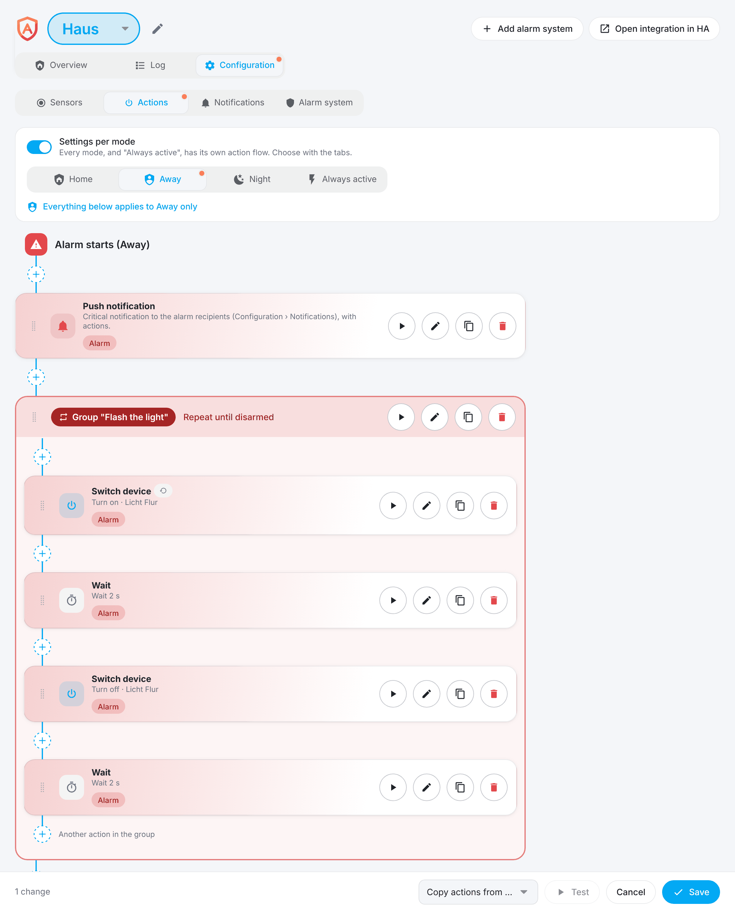</p>

- **Steps keep running:** by default the next step starts right away, so the actions run through one after the other as fast as possible. With "Wait until the action has finished" the next one starts only when this one is done; the step then carries a pill. A sound "until disarmed" cannot be waited for. Flows from earlier versions behave as before.
- **Four kinds of tones, each with its own sounds:** the **alarm sound** (the sound of the alarm, five sounds from siren to yelp; the push button "Silence alarm sound" stops it), the **pre-alarm** (a quiet warning tone before the alarm sound, five sounds such as chime, warning or a slow beep; the next step follows after it) the **arming tone** (short, subtle or friendly, seven sounds from beep to a rising triad) and the **disarming tone** (its counterpart, five falling sounds such as a descending triad or a deep bell). You can preview each one in the panel. A tone plays in one piece for its whole duration: the speaker is started once, and the tone begins and ends softly. You set the volume for all media players together or for each one separately, for example quieter in the bedroom.
- **Fixed messages:** "Armed" (below "Alarm system armed"), "Silent alarm" (in the chapter "On a silent alarm"), "Entry delay" (below "Entry delay running"), "Disarmed" (below "Alarm system disarmed") and the closing message (below "Alarm ends") are fixed elements of the flow, per alarm system and with "Settings per mode" per mode; the "Always active" tab only has "Silent alarm". The switch on the card turns the message on and off, play sends a test message with the values of the card (unsaved ones too; disabled when off), the pencil opens its window: own title and text (left empty, the standard text applies) with the placeholders {name}, {mode}, {time}, when arming or disarming {person} (who did it; empty if nobody is known), for sensors {sensor}, {type}, {area} and for the entry delay {delay}; recipients (the standard recipients of alarms are preselected), critical with volume, "keep in Home Assistant", tap target and a test message with the values from the window. After an alarm the closing message goes out instead of "Disarmed"; it replaces the alarm message on the phone. When it is switched off, nothing goes out and the alarm message stays. As long as an alarm system has not saved anything of its own for a mode, the settings that were in the Notifications tab up to 1.61.0 apply.
- **On a silent alarm:** the chapter comes before "On an alarm". When a sensor with the option "Silent alarm" responds, the message goes out and the actions below the point "Silent alarm" run: arming tone, device, wait, scene, custom action, also in a group (number or duration). There is never an alarm, so there is no siren, no alarm message and no acknowledging. At most once per sensor and minute. The list of the mode the alarm system is armed in applies, for always-active sensors the list in the "Always active" tab (also while disarmed). An alarm, a test and a running entry or exit delay have priority: then they do not start. They replace a running arming tone or an earlier silent alarm; an alarm or disarming ends them at once. Devices are not restored.
- **Play buttons:** every play button turns red when pressed and becomes a stop button, the same everywhere. What runs (a test of the actions, a sound) is stopped by stop. A test message is already on its way once sent: its button stays red until the server answers (at least 1.5 seconds), there stop only ends the display.
- **When arming:** below "Alarm system armed" there are actions that run as soon as the system is armed, per mode: for example an arming tone (a short beep, you set how long it sounds), plus device, wait, scene and custom action. Disarming stops a running tone at once, an alarm has priority.
- **During the delays:** "Arming begins" (while the exit delay runs) and "Entry delay running" (while the time to disarm runs) are fixed points of their own, per mode. Arming tone or pre-alarm there can last exactly as long as the delay that is running (a switch in the step), so it tells everyone to leave or to disarm. The alarm never waits for these actions. The points only show where the delay exists (above 0). Drag a step by its handle onto another list (also an empty one) to move it there; lists only take the steps that make sense in them; near the edge the page scrolls along.
- **Zone colours:** every zone of the flow has its own colour (exit delay light orange, entry delay dark orange, armed light red, silent alarm blue-grey, alarm dark red, after acknowledging light green, on disarming dark green). The steps run from that colour to neutral, the line between them carries it, and a pill on every step names the zone, so you see at a glance where a step belongs.
- **Your own sounds:** every list of sounds ends with "Upload your own sound …". Give it a name, choose a file with "Upload" and press "Save" (WAV; MP3, OGG, FLAC and M4A are converted with PyAV, which Home Assistant brings along, or with the program ffmpeg; up to 30 seconds, 8 MB). The sound is then available in all four kinds of tones and in every alarm system, and steps only refer to it. Rename and delete in Configuration › System › "Your own sounds". Only administrators upload. Own sounds are part of the backup. If you delete a sound that is still used, the panel tells you how many steps it affects; these steps then play the standard sound of their kind, so an alarm still sounds. Under Configuration › Alarm system › Your own sounds, the button "Show sounds" opens the list (play, rename, delete, upload; with a search field), and "Upload sound" next to it opens the form right away. A sound is stored at once; if you uploaded it in the editor of a step, an orange note reminds you that the step still has to be saved.

<p align="center">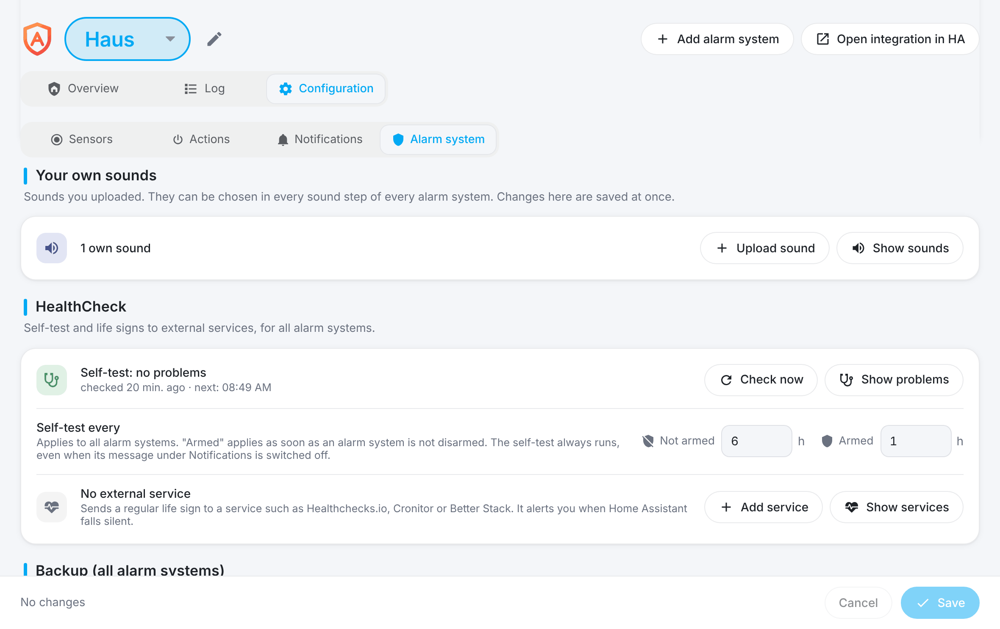</p>

- **Tones put the speaker back.** Arming tone, disarming tone, pre-alarm and the alarm sound in the lists outside the alarm flow remember how the speaker was (on or off, volume, playback), play at the chosen volume and put it back afterwards. On by default, switchable per step.
- **When disarming:** at the very bottom of the actions page the chapter "When disarming" has a list of its own under the fixed point "Alarm system disarmed", per mode (the mode that was armed). Whatever you put there always runs when the alarm system is disarmed, also in the middle of a delay or an alarm (after the actions after acknowledging): for example a disarming tone, a device, a wait, a scene or your own action. Arming again or an alarm ends it at once.
- **After acknowledging:** behind "Alarm ends (acknowledged)" there are actions of their own that run as soon as the alarm is acknowledged or the system is disarmed, for example close the blinds or switch off a light. Possible are device, sound with a duration, wait, scene and custom action. A new alarm cancels them.
- **Back to the previous state:** on or off, brightness, position, volume and source; media players that can save their whole playback (source, title, group) use that.
- **Test:** runs the saved flow without an alarm and stops after 60 seconds at the latest. A real alarm during a test starts the real flow at once.
- **Media players** fetch the sounds from Home Assistant, so they must reach its local URL (Settings → System → Network).
- **Buttons of the alarm notification:** "Open" (on by default), "Silence alarm sound" (stops the steps, the alarm stays), "Acknowledge" (on by default; ends the alarm, the alarm system stays armed and alarms again at the next trigger) and "Disarm" (iOS asks for Face ID or the passcode, Android does not).
- **Critical notifications:** the volume applies to iOS; Android plays them on the alarm channel, set its volume on the phone.
- **Maintenance messages:** each problem once, several in one notification, again after the battery was replaced or the sensor responded. A battery counts as low only when it is below the threshold at several checks in a row (default 3, maintenance checks every 15 minutes, 1 to 10); a value above the threshold starts again, a battery sensor without a value neither counts nor starts again. A single wrong value of a device sends nothing (since 1.68.0). The same for the self-test: again only when a problem comes back after it was fixed. A HealthCheck service: "not answering" once per outage (also across a restart of Home Assistant), "answers again" once afterwards.
- **Battery forecast:** from the long-term statistics of Home Assistant over one year since the last battery change (otherwise from the history), the same as the battery tab of the sensor view with "1 year"; empty when the battery has not dropped or there is not enough data (at least 3 days).

### Routines, backup and HomeKit in detail

- **Routines:** under Configuration › Alarm system. The trigger is a **schedule** (one or more times with weekdays) or a **device** (a lock, switch, door sensor, person, each button of a remote or dimmer with each kind of press ...; conditions "device is state", "button press" and "time of day", combined with "and"/"or", with one level of groups, optionally "must hold for N seconds"). A routine runs when its conditions newly come true: not while they stay true, not after a restart of Home Assistant and not on the return from "unavailable" (a radio outage never switches the alarm system). Per routine five switches choose the alarm states in which it may run (exit delay, armed, entry delay, during the alarm, disarmed; only the last is on by default); at the moment of triggering the state counts, otherwise the routine is skipped and the log says so. Arming never applies during an entry delay or an alarm. Open sensors block arming as usual; no code is needed. A routine does not trigger another one, and a routine never runs twice within 10 seconds.
- **Routines in the panel:** the page shows a summary and the buttons "Add routine" and "Show routines"; the list opens in its own window (full screen on the phone), changes are saved with "Save" of the page. Until then new and changed routines carry the orange mark "Not saved yet". Every routine is a row with its trigger in plain words, its target and tags ("Bypasses the code", the states it applies in). The search field above the list finds everything the rows show and the entity IDs of the devices; title and search field stay at the top while scrolling (also in the windows "Your own sounds", "Backups" and "Codes per person"). The pencil opens the editor, which ends with a preview of the flow (trigger, check of the alarm state, action or "Skipped"). The eye before it shows the same preview read-only, in the same window: "Close" leads back to the list, "Edit" opens the editor.

<p align="center">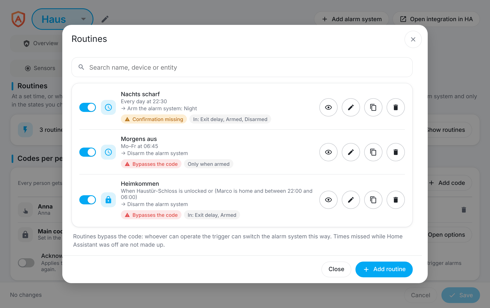</p>

- **Only "Disarmed" needs no confirmation.** A routine runs only in the states you choose. A new routine starts with just "Disarmed"; every other state (arming, armed, entry delay, alarm) first needs the confirmation "I understand this" under "Safety", for disarming and for arming alike: whoever can operate the trigger would otherwise disarm or switch the mode (for example from Home to Away) without a code. Until you confirm, the other states cannot be switched on, and turning the confirmation off drops them again. Disarming in other states carries the tag "Bypasses the code". Routines saved before this rule keep working and show the tag "Confirmation missing" until you save them again. Schedules from earlier versions became routines when updating (states: exit delay, armed, disarmed); old backups are converted on restoring.
- **Backup:** up to 10 backups of your own in the integration, plus the last automatic ones (5 by default, you choose 1 to 50; switch, number and interval under Configuration › Alarm system › Backup, saved with "Save" of the page; checked every night at 03:17 and after a start; no identical copy is stored), plus export and import as a file. The page shows "Last backup" at the top with the buttons "Create backup" and "Show backups" (like routines, your own sounds and codes), below it the automatic backup. The list of backups opens in its own window, with export and import, a search field and the filter "Automatic only". When restoring you choose for each alarm system of the backup what it is applied to: an existing alarm system (whatever its name), a new one, or none; the shared settings can be left out. The HealthCheck services are included with their URL. Codes are never included; the backup of Home Assistant itself contains everything. "What is in a backup?" above the card opens the full list: per alarm system name, modes, sensors and zones, options per sensor, delays and behaviour, all actions, routines, monitoring rules and the notifications per event; for all alarm systems presets per sensor type, notifications (with the intervals of the self-test), how names are shown, your own sounds and the HealthCheck services. Not included: codes and the main code, the log (alarms, events, alarm recordings), history and statistics of the sensors, the state of the alarm systems, results of the self-test and the life signs (with the log of the HealthCheck services), the automatic backup setting and the view settings of your browser.
- **Codes per person in the panel:** under Configuration › Alarm system the page shows the number of codes with the buttons "Add code" and "Show codes" (like routines and your own sounds), plus the main code and "Acknowledging asks for the code". The window (full screen on the phone) shows a table with name and user, sortable, with a search field, and per row round buttons to edit and remove. A code is never shown: only a hash is stored, no code can be shown again. The pencil opens the same window as "Add code" (in the footer) with name and user; empty code fields keep the current code. The eye in the code field shows the code you are typing and hides it again. Simple codes show a red warning (sequences like 1234 or 2468, only one digit, repeated patterns like 1212 or 1122, three equal digits in a row, mirrored numbers, lines on the keypad like 2580, years, dates like 24121990); they can still be saved. Codes with fewer than 4 or more than 8 digits are not accepted by the integration.
- **HomeKit, exit delay:** Apple Home shows "Off" with the target "Away" during the exit delay. Use no exit delay for "Home" and "Night" (default).
- **HomeKit, entry delay:** Apple Home keeps showing "armed" and switches to "Alarm" when the alarm starts.

### For developers

```bash
pip install -r requirements_test.txt
python -m pytest                      # tests against a real Home Assistant
python scripts/mutation_check.py      # removes each safeguard, a test must fail
cd tests/panel && npm ci && node run.mjs   # interface tests (Playwright)
```

- The images of the README and of this manual come from the simulator: `node tests/panel/readme-shots.mjs`, then `python scripts/optimize_images.py`; the diagrams from `python scripts/make_diagrams.py`.
- Concept and decisions: [docs/CONCEPT.md](https://github.com/Diegofuego871/ha-alarmageddon/blob/main/docs/CONCEPT.md) (German). Changes: [CHANGELOG.md](https://github.com/Diegofuego871/ha-alarmageddon/blob/main/CHANGELOG.md).
